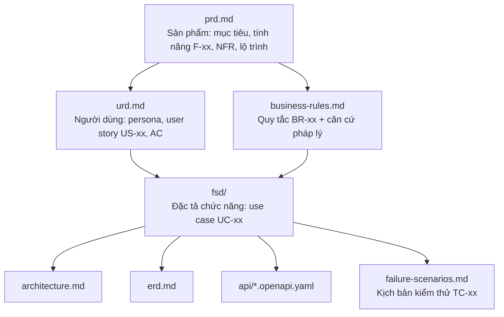

# Tài liệu dự án E-Wallet

Mục lục và quy ước của bộ tài liệu. Đọc theo thứ tự từ trên xuống: **vì sao → cho ai → làm gì → chạy chi tiết ra sao → xây thế nào**.

## 1. Phân cấp tài liệu

| Tài liệu | Loại (chuẩn BA) | Trả lời câu hỏi | Người đọc chính | Trạng thái |
|---|---|---|---|---|
| [prd.md](prd.md) | **PRD** (gộp BRD) | Sản phẩm giải quyết vấn đề gì, gồm tính năng nào, ưu tiên ra sao, khi nào xong, đo thành công thế nào | Tất cả | Reviewed |
| [urd.md](urd.md) | **URD** | Từng nhóm người dùng cần làm gì; thế nào là đạt | BA, dev, tester | Reviewed |
| [business-rules.md](business-rules.md) | Business rules catalogue (một phần của SRS) | Quy tắc nghiệp vụ nào bắt buộc, căn cứ pháp lý nào | BA, dev | Reviewed |
| [fsd/](fsd/) | **FSD / SRS** | Mỗi chức năng chạy chi tiết ra sao: luồng chính/thay thế/ngoại lệ, màn hình, validation, thông báo | Dev, tester | Draft — phạm vi M0 |
| [architecture.md](architecture.md) | TDD / SAD | Hệ thống được chia thành những thành phần nào, giao tiếp ra sao | Dev | Reviewed |
| [erd.md](erd.md) | TDD — mô hình dữ liệu | Dữ liệu lưu thế nào, ràng buộc gì, bút toán ra sao | Dev | Reviewed |
| [wallet-core `api/openapi.yaml`](https://github.com/Hungnd562k/E-Wallet-Wallet-Core/blob/development/api/openapi.yaml) (nguồn chuẩn ở repo `E-Wallet-Wallet-Core`), [api/corebank.openapi.yaml](api/corebank.openapi.yaml) | Interface spec | Hợp đồng API giữa các hệ thống | Dev (BE, FE, mobile) | Draft, lint sạch |
| `failure-scenarios.md` | Test spec | Các kịch bản lỗi và cách kiểm chứng | Dev, tester | Chưa viết |
| [Q&A.md](Q&A.md) | Ghi chú cá nhân | Giải thích thuật ngữ | — | — |
| [chuan-hoa/](chuan-hoa/README.md) | Báo cáo chuẩn hóa tài liệu (A–I) | Bộ tài liệu đang có vấn đề gì, cần xác nhận gì, đã sẵn sàng tới đâu | Chủ dự án, BA | Draft — 2026-10-21 |

## 2. Quy ước ID và chuỗi truy vết

| Tiền tố | Ý nghĩa | Định nghĩa tại |
|---|---|---|
| `SM-xx` | Chỉ số thành công | prd.md §3 |
| `F-xx` | Tính năng | prd.md §7 |
| `NFR-xx` | Yêu cầu phi chức năng (hệ thống) | prd.md §8 |
| `P1…P7` | Persona | urd.md §1 |
| `US-xx` | User story | urd.md §2 |
| `UR-NF-xx` | Yêu cầu phi chức năng (người dùng) | urd.md §3 |
| `BR-xx` | Quy tắc nghiệp vụ, nhãn **[L]** luật / **[P]** quyết định sản phẩm | business-rules.md §4 |
| `UC-<file>.<nn>` | Use case, ví dụ `UC-04.01` | fsd/*.md |
| `S-<file>.<n>` | Màn hình, ví dụ `S-04.3` | fsd/*.md |
| `CF-xx` | Hành vi dùng chung của mọi use case | fsd/README.md §4 |
| `ADR-xx` | Quyết định kiến trúc | architecture.md §13 |
| `TC-xx` | Kịch bản kiểm thử | failure-scenarios.md |

Chuỗi truy vết: **Persona → US → F → UC → BR → API `operationId` / bảng ERD → TC**.

Ví dụ: P1 Lan → US-21 chuyển ví–ví → F-05 → UC-04.01 → BR-24, 25, 29, 36 → `createTransfer`, `ledger.entries`, `limits.usage` → TC chuyển song song.

## 3. Quy ước viết

- Tiếng Việt, thuật ngữ kỹ thuật giữ nguyên tiếng Anh khi không có từ tương đương phổ biến.
- Mỗi tài liệu có dòng đầu: **Trạng thái · Ngày cập nhật · Liên quan**.
- Không lặp lại nội dung: tài liệu sau **trỏ tới** tài liệu trước bằng ID, không chép lại quy tắc.
- Mọi con số (hạn mức, ngưỡng, thời hạn) là tham số cấu hình — xem business-rules.md §5.

## 4. Lịch sử cấu trúc

- 2026-10-17: chuẩn hóa theo URD / PRD / FSD.
  - `planning.md` → `prd.md`; phần kỹ thuật của file cũ chuyển sang architecture / erd / api.
  - `scope.md` → `business-rules.md`.
  - `money-flows.md` (đã dự kiến trước đó) không tạo riêng nữa: sequence diagram và bút toán của từng luồng tiền nằm trong file FSD tương ứng.
