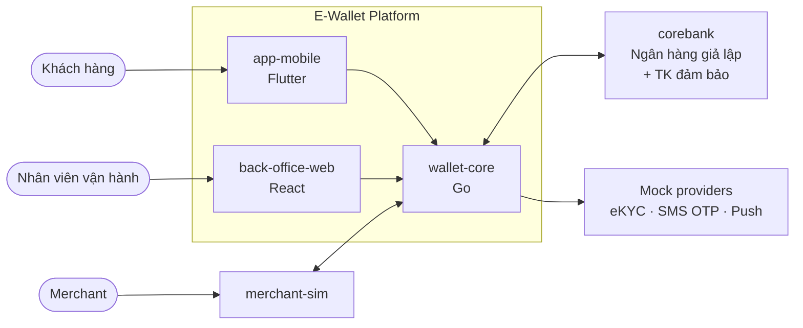
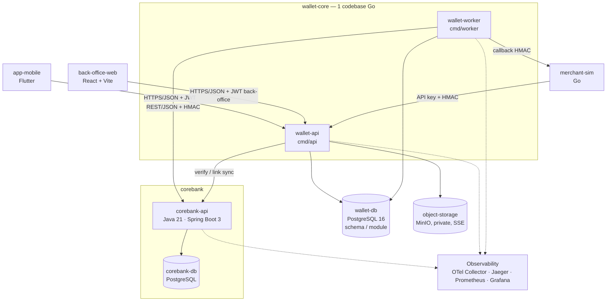
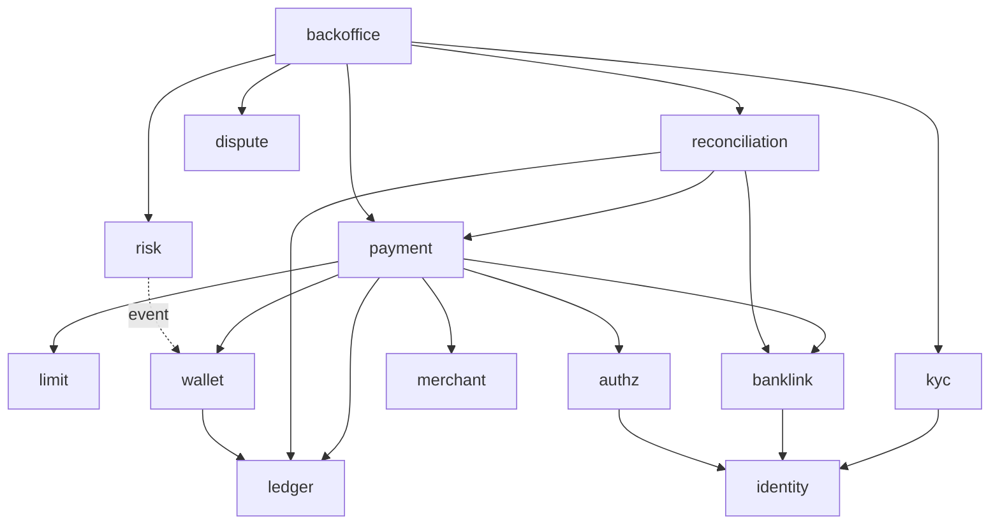
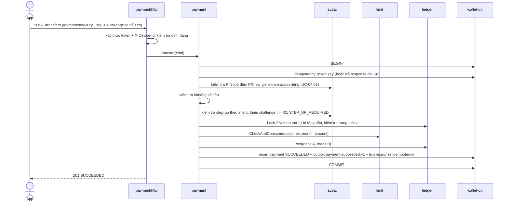
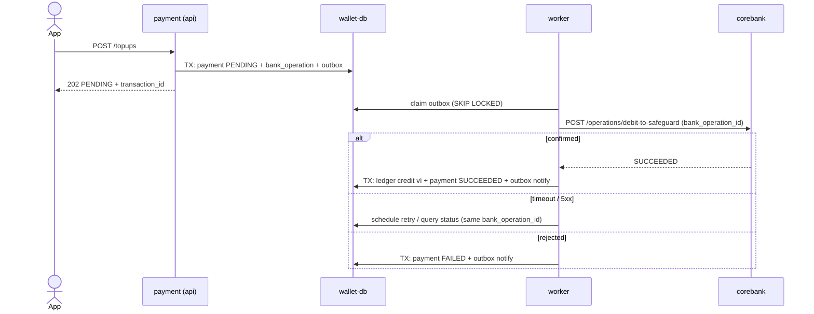

# Architecture — E-Wallet Platform

> Trạng thái: **DRAFT — chờ review** · Cập nhật: 2026-10-17
> Liên quan: [README](README.md) · [prd.md](prd.md) · [business-rules.md](business-rules.md) (mã `BR-xx`)

## 1. Mục tiêu & thuộc tính chất lượng

Xếp theo thứ tự ưu tiên. Khi xung đột, mục trên thắng mục dưới.

| # | Thuộc tính | Ý nghĩa cụ thể |
|---|---|---|
| 1 | **Đúng về tiền** | Không mất tiền, không ghi trùng, ledger luôn cân bằng, số dư không âm |
| 2 | **Truy vết & kiểm toán** | Mọi thay đổi tiền/trạng thái đều truy được: ai, khi nào, vì sao, request nào |
| 3 | **Bảo mật dữ liệu định danh** | CCCD, sinh trắc học, PIN, token không lộ qua API, log, DB dump |
| 4 | **Phục hồi** | Crash, timeout, mất response đều không làm sai số dư; hệ thống tự tiếp tục được |
| 5 | **Dễ phát triển cho 1 người** | Ít thành phần hạ tầng, một lệnh `docker compose up` |
| 6 | Hiệu năng / scale | Đủ dùng cho demo; không tối ưu sớm |

Khi phải chọn giữa nhất quán và sẵn sàng, hệ thống **chọn nhất quán**: thà trả `PENDING` hoặc từ chối còn hơn trả kết quả sai.

---

## 2. System context (C4 mức 1)



| Phần tử | Loại | Ghi chú |
|---|---|---|
| Khách hàng | Actor | Cá nhân, đủ 18 tuổi, đã eKYC (BR-01, BR-05) |
| Nhân viên vận hành | Actor | Tra cứu, xử lý pending, đối soát, khiếu nại, duyệt điều chỉnh |
| Merchant | Actor | Tổ chức có hợp đồng (BR-53), tương tác qua `merchant-sim` |
| `corebank` | Hệ thống ngoài (giả lập) | Giữ TK thanh toán của khách hàng và **TK đảm bảo** của công ty ví (BR-55) |
| Mock providers | Hệ thống ngoài (giả lập) | OCR, liveness, face match, đối chiếu chip CCCD/VNeID, SMS OTP, push. Nằm trong `wallet-core` dưới dạng adapter, có thể cấu hình độ trễ và lỗi |

---

## 3. Containers (C4 mức 2)



| Container | Công nghệ | Trách nhiệm |
|---|---|---|
| `wallet-api` | Go 1.23+, `net/http` + `chi` | REST API cho mobile, back-office, merchant. Xác thực, phân quyền, validation, rate limit, idempotency. Thực hiện các nghiệp vụ đồng bộ (chuyển ví–ví, thanh toán QR) và ghi outbox. |
| `wallet-worker` | Go (cùng codebase) | Outbox dispatcher, gọi corebank (nạp/rút/chuyển), retry và tra cứu trạng thái, callback cho merchant, notification, AML, scheduler (đối soát, giấy tờ hết hạn, ví không hoạt động…). |
| `wallet-db` | PostgreSQL 16 | Một database, **mỗi module một schema**. Nguồn sự thật về ví và ledger. |
| `object-storage` | MinIO (S3 API) | Ảnh CCCD, selfie. Bucket private, bật mã hóa phía server. |
| `corebank-api` | Java 21, Spring Boot 3 | Ngân hàng giả lập: TK khách hàng, TK đảm bảo, ghi nợ/ghi có, chuyển liên ngân hàng (mạng giả lập), idempotency, tra cứu, sao kê. Có **fault injection**. |
| `corebank-db` | PostgreSQL (database riêng) | Không chia sẻ với wallet, kể cả khi chạy chung Postgres server trong môi trường local. |
| `merchant-sim` | Go (app nhỏ, tách riêng) | Tạo đơn hàng, hiển thị QR, nhận callback, tra cứu trạng thái đơn. |
| `app-mobile` | Flutter | Kênh khách hàng. Chỉ gửi yêu cầu và hiển thị, không tự quyết định số dư hay trạng thái. |
| `back-office-web` | React + Vite + TypeScript | Kênh vận hành, làm ở M3. Trước đó dùng API, Bruno hoặc HTTP files. |
| Observability | OTel Collector, Jaeger, Prometheus, Grafana | Bật bằng Compose profile `obs`, không bắt buộc khi dev. |

Vì sao `api` và `worker` là 2 process: request của người dùng không bị chặn bởi các thao tác chậm với ngân hàng, và có thể scale riêng. Cả hai dùng chung codebase, chung domain và chung DB, nên vẫn là **modular monolith**.

---

## 4. Module trong `wallet-core` (C4 mức 3)

### 4.1. Danh sách module

| Module | Trách nhiệm | Schema / bảng sở hữu (sơ bộ) | BR |
|---|---|---|---|
| `identity` | Đăng ký SĐT + OTP, đăng nhập, phát hành JWT, refresh token, thiết bị, PIN, đồng ý xử lý dữ liệu | `identity`: customers, phone_verifications, devices, credentials, refresh_tokens, consents | BR-01…03, 38, 39, 70 |
| `kyc` | Phiên eKYC, workflow, provider adapters (OCR/liveness/face/chip), lưu ảnh, theo dõi hạn giấy tờ | `kyc`: sessions, documents, checks, verified_identities | BR-04, 06…08 |
| `wallet` | Ví, vòng đời ví (`ACTIVE`, `SUSPENDED`, `FROZEN`, `CLOSED`), đóng ví, ví không hoạt động | `wallet`: wallets, status_history | BR-05, 06, 07, 62, 63 |
| `ledger` | Tài khoản kế toán, bút toán double-entry, số dư khả dụng/hold. **Module duy nhất được thay đổi số dư.** | `ledger`: accounts, transactions, entries, holds | BR-24, 50, 57 |
| `limit` | Bộ đếm hạn mức theo tháng/ngày/nhóm; kiểm tra và cộng dồn trong cùng transaction với bút toán | `limits`: usage, consumptions | BR-25…29, 37 |
| `authz` | Step-up authentication: quyết định cấp xác thực (PIN / OTP + khuôn mặt) và quản lý challenge gắn với giao dịch | `authz`: challenges | BR-35…40 |
| `payment` | Orchestrator cho topup, transfer, payout, interbank, QR payment, refund; máy trạng thái; lịch sử giao dịch (read-model) | `payment`: payments, status_history, wallet_activities | BR-20…23, 45…52 |
| `banklink` | Liên kết NH, `BankGateway` (adapter tới corebank), bank operations | `banklink`: links, operations, operation_attempts | BR-10…14, 22, 49 |
| `merchant` | Merchant, API key, đơn hàng, QR token, callback | `merchant`: merchants, api_keys, orders, refunds, callback_deliveries | BR-51…53 |
| `reconciliation` | Đối soát T+1, kiểm tra bất biến TK đảm bảo, case chênh lệch, điều chỉnh maker–checker | `recon`: runs, items, adjustments | BR-56, 58, 64 |
| `risk` | Rule AML, `aml_alerts`, tạm dừng ví khi nghi gian lận | `risk`: aml_alerts | BR-61, 74 |
| `dispute` | Tra soát / khiếu nại | `dispute`: disputes | BR-47, 60 |
| `notification` | Push/SMS (mock), template | `notification`: notifications | — |
| `audit` | Audit log append-only | `audit`: audit_logs | BR-64, 71 |
| `backoffice` | Lớp HTTP cho back-office: gom API của các module, RBAC, tài khoản nhân viên; không chứa logic nghiệp vụ | `backoffice`: staff_users, staff_sessions | BR-64 |
| `platform` | Hạ tầng dùng chung: db/tx, outbox, idempotency, auth middleware, crypto, config, clock, id, observability, httpx | `platform`: settings, outbox_events, processed_events, idempotency_keys, job_runs | — |

Chi tiết cột, ràng buộc và quan hệ: [`erd.md`](erd.md). Schema của module `limit` tên là `limits` (`LIMIT` là từ khóa SQL).

### 4.2. Cấu trúc package

```text
wallet-core/
├── cmd/
│   ├── api/main.go          # wiring HTTP + module
│   └── worker/main.go       # wiring outbox, jobs, scheduler
├── internal/
│   ├── ledger/
│   │   ├── service.go       # API public của module (interface + DTO)
│   │   ├── domain/          # Account, Entry, invariants
│   │   ├── store/           # sqlc queries, repository (private)
│   │   └── ledger_test.go
│   ├── payment/
│   │   ├── service.go
│   │   ├── domain/          # state machine
│   │   ├── store/
│   │   ├── http/            # handlers + DTO (transport)
│   │   └── jobs/            # outbox consumers (worker)
│   ├── identity/ kyc/ wallet/ limit/ authz/ banklink/ merchant/
│   ├── reconciliation/ risk/ dispute/ notification/ audit/ backoffice/
│   └── platform/
│       ├── db/              # pool, WithTx, DBTX
│       ├── outbox/
│       ├── idempotency/
│       ├── auth/            # JWT, middleware
│       ├── crypto/          # envelope encryption, HMAC
│       ├── httpx/           # error mapping, middleware
│       ├── observability/   # slog redaction, OTel, metrics
│       └── config/ clock/ id/
├── migrations/              # golang-migrate, đặt tên theo module
├── api/openapi.yaml
└── go.mod
```

Module nhỏ (`notification`, `dispute`) không cần đủ các package con.

### 4.3. Quy tắc phụ thuộc



1. Module khác chỉ được gọi **API public** của một module, tức `internal/<module>/service.go`. Các package con (`domain`, `store`, `http`, `jobs`) là riêng của module.
2. Module **không** đọc/ghi schema của module khác và không join chéo schema. Ngoại lệ duy nhất là read-model lịch sử giao dịch do `payment` sở hữu và tự cập nhật.
3. `ledger` và `limit` không phụ thuộc module nghiệp vụ nào. `platform` không phụ thuộc module nào.
4. Đồ thị phụ thuộc không có vòng. Khi cần đi ngược chiều (ví dụ `risk` muốn tạm dừng ví), dùng **event qua outbox** hoặc một interface do bên gọi định nghĩa.
5. Interface cho hệ thống ngoài được định nghĩa **ở phía sử dụng**: `banklink` định nghĩa `BankGateway`, adapter corebank triển khai nó.
6. Có test kiến trúc (dựa trên import graph `go list -deps`) chạy trong CI để ép các quy tắc 1–4.

---

## 5. Giao tiếp & transaction trong monolith

### 5.1. Hai kiểu giao tiếp

| Kiểu | Khi nào dùng | Cơ chế |
|---|---|---|
| **Đồng bộ, chung transaction** | Mọi thao tác **thay đổi tiền**: payment + ledger + limit + idempotency + outbox | Gọi hàm in-process. `platform/db.WithTx(ctx, fn)` gắn `pgx.Tx` vào `ctx`; mọi repository nhận `DBTX` lấy từ `ctx`, nên tất cả commit hoặc rollback cùng nhau. |
| **Bất đồng bộ, qua outbox** | Side-effect: gọi corebank, callback merchant, notification, AML, audit phụ | Ghi `platform.outbox_events` trong cùng transaction. Worker dispatch với ngữ nghĩa **at-least-once**. Consumer idempotent nhờ `processed_events(consumer, event_id)`. |

Đây là lợi thế lớn nhất của modular monolith: **atomic transaction xuyên module mà không cần saga**.

Event có tên kèm phiên bản và payload JSON có schema, ví dụ: `payment.succeeded.v1`, `payment.pending_bank.v1`, `wallet.suspended.v1`, `kyc.verified.v1`. Mỗi event mang `event_id`, `occurred_at`, `trace_context`, `correlation_id`.

### 5.2. Chuyển ví–ví (đồng bộ, một transaction)



Thứ tự kiểm tra chi tiết và mã lỗi của từng bước: [fsd/04 UC-04.01 §Xử lý phía hệ thống](fsd/04-p2p-transfer.md#xử-lý-phía-hệ-thống).

Bất kỳ bước nào lỗi thì toàn bộ rollback: hạn mức không bị trừ, không có bút toán. Riêng key idempotency: kết quả lỗi nghiệp vụ `422` vẫn được lưu gắn với key để request lặp lại nhận cùng kết quả; `401`, `423`, `409`, `429`, `5xx` không chiếm key (fsd/README CF-04 bước 5).

### 5.3. Nạp tiền (đồng bộ ghi nhận + bất đồng bộ với ngân hàng)



Rút tiền và chuyển liên ngân hàng dùng cùng khung này, khác ở chỗ ledger **hold** tiền ngay trong transaction đầu tiên (BR-50).

### 5.4. Lộ trình nếu tách microservices sau này

Chỉ để định hướng, **không làm trong MVP**:

- Outbox chuyển sang publish lên broker (NATS JetStream hoặc Kafka); consumer giữ nguyên tính idempotent.
- Module tách ra đầu tiên nên là các module ít ràng buộc transaction: `notification`, `kyc`, `merchant`.
- `ledger` tách sau cùng. Khi tách, thao tác chuyển tiền cần cơ chế reservation + saga thay cho transaction chung.

---

## 6. Process model của `wallet-worker`

| Thành phần | Cơ chế | BR |
|---|---|---|
| Outbox dispatcher | `SELECT … FOR UPDATE SKIP LOCKED` + lease (`locked_until`); exponential backoff có jitter; quá `max_attempts` thì chuyển `DEAD` và báo alert | — |
| Bank operation runner | Gọi corebank bằng `bank_operation_id` ổn định; timeout mỗi lần gọi 10s; kết quả chưa rõ thì tra cứu `GET /operations/{id}`; sau 24h chưa rõ thì `NEEDS_RECONCILIATION` | BR-46, 49, 50 |
| Merchant callback | Ký HMAC; retry backoff tối đa 24h | BR-51 |
| Scheduler | Mỗi job lấy **Postgres advisory lock** nên chỉ một instance chạy; lưu lịch sử chạy | — |
| ↳ `recon.daily` (01:00) | Đối soát T+1 và kiểm tra bất biến TK đảm bảo | BR-56, 58 |
| ↳ `kyc.id_expiry` (hằng ngày) | Thông báo trước 30 ngày; tới hạn thì `SUSPENDED` | BR-07 |
| ↳ `wallet.dormant` (hằng ngày) | Báo trước rồi đóng ví không hoạt động | BR-63 |
| ↳ `merchant.qr_expiry` (mỗi phút) | Đơn hàng quá 15 phút chuyển `EXPIRED` | BR-52 |
| ↳ `platform.cleanup` | Dọn idempotency key (> 7 ngày), `processed_events` cũ | — |

Worker chạy được nhiều instance song song và graceful shutdown: nhận SIGTERM thì ngừng claim job mới, chờ job đang chạy xong (tối đa 30s), lease hết hạn thì instance khác nhận lại.

---

## 7. Hợp đồng tích hợp

### 7.1. wallet ↔ corebank

- REST/JSON. Mỗi request mang `X-Client-Id`, `X-Timestamp`, `X-Signature` (HMAC-SHA256 của method, path, timestamp và body); lệch thời gian quá ±5 phút thì bị từ chối. mTLS để sau.
- Idempotency: mọi lệnh tiền mang **`bank_operation_id`** do wallet sinh. corebank gặp id đã có thì trả lại đúng kết quả cũ; cùng id mà payload khác thì trả `409`.
- Kết quả gồm `status ∈ {SUCCEEDED, REJECTED, PROCESSING}` và `reason_code`. `REJECTED_*` là kết luận cuối. Lỗi mạng, timeout, `5xx`, `PROCESSING` đều được coi là **chưa rõ**, phải tra cứu.

| Method | Endpoint | Mục đích | BR |
|---|---|---|---|
| POST | `/v1/accounts/verify-ownership` | Kiểm tra số TK/thẻ ghi nợ, họ tên, số CCCD khớp; từ chối thẻ tín dụng | BR-10, 11 |
| POST | `/v1/links` | Khởi tạo liên kết, corebank gửi OTP (mock) | BR-14 |
| POST | `/v1/links/{link_id}/confirm` | Xác nhận OTP, trả về `link_token` | BR-14 |
| DELETE | `/v1/links/{link_id}` | Hủy liên kết | BR-13 |
| POST | `/v1/operations/debit-to-safeguard` | Nạp tiền: TK KH → TK đảm bảo | BR-20, 55 |
| POST | `/v1/operations/credit-from-safeguard` | Rút tiền: TK đảm bảo → TK liên kết | BR-21, 55 |
| POST | `/v1/operations/interbank-transfer` | TK đảm bảo → TK bất kỳ (mạng giả lập), kèm thông tin người gửi | BR-22 |
| GET | `/v1/operations/{bank_operation_id}` | Tra cứu trạng thái | BR-46, 49 |
| GET | `/v1/safeguard/balance` | Số dư TK đảm bảo | BR-56 |
| GET | `/v1/statements?account=safeguard&date=YYYY-MM-DD` | Sao kê phục vụ đối soát | BR-58 |

**Fault injection** chỉ bật ở profile `dev`/`test`. Bật bằng cấu hình theo endpoint hoặc header `X-Fault` (corebank chỉ chấp nhận header này từ client test):

| Fault | Hành vi |
|---|---|
| `delay=<ms>` | Trả chậm |
| `timeout` | Không trả response |
| `commit-then-drop` | Commit giao dịch rồi đóng kết nối, không trả response |
| `reject=<code>` | Trả `REJECTED_<code>` |
| `processing=<n>` | Trả `PROCESSING` cho n lần tra cứu đầu |
| `5xx` | Lỗi server |

### 7.2. wallet ↔ merchant-sim

| Hướng | Endpoint | Ghi chú |
|---|---|---|
| merchant → wallet | `POST /merchant/v1/orders` | API key + HMAC. `(merchant_id, order_id)` unique. Trả `qr_token` (ngẫu nhiên, 128-bit) và `expires_at` |
| merchant → wallet | `GET /merchant/v1/orders/{order_id}` | Tra cứu trạng thái đơn |
| merchant → wallet | `POST /merchant/v1/orders/{order_id}/refunds` | Hoàn tiền ≤ số đã thanh toán, trong 90 ngày (BR-48) |
| wallet → merchant | `POST {callback_url}` | Event `order.paid` / `order.refunded`, ký HMAC, retry 24h |

Nội dung QR **chỉ chứa** `qr_token` (ví dụ `ewallet://pay?t=<qr_token>`). App gọi `GET /v1/qr/{qr_token}` để lấy merchant, số tiền và hạn từ backend (BR-52).

### 7.3. wallet ↔ client (mobile, back-office)

Nguyên tắc chung (tiền là số nguyên, idempotency, mã lỗi chuẩn hóa, correlation id, OpenAPI là nguồn chuẩn), bổ sung:

- Header bắt buộc: `Authorization`, `X-Device-Id`, `X-Request-Id`. Thêm `Idempotency-Key` cho mọi lệnh tạo giao dịch.
- **Step-up flow** (BR-36, 40):
  1. Client gửi lệnh.
  2. Nếu cần xác thực mạnh, server trả `401 { "error": "STEP_UP_REQUIRED", "challenge_id", "methods": ["OTP","FACE"] }`.
  3. Client hoàn tất challenge qua `/v1/challenges/{id}/...`.
  4. Client gửi lại lệnh **với cùng `Idempotency-Key`** kèm `X-Challenge-Id`.
- Lỗi có định dạng thống nhất: `{ "error": "<CODE>", "message", "details", "request_id" }`. Mã lỗi nghiệp vụ map sang `4xx`, chỉ lỗi hệ thống mới là `5xx`.
- API back-office nằm dưới `/admin/v1/*` và dùng token realm khác.

Contract chi tiết (OpenAPI 3.1): [`E-Wallet-Wallet-Core/api/openapi.yaml`](https://github.com/Hungnd562k/E-Wallet-Wallet-Core/blob/main/api/openapi.yaml) (nguồn chuẩn, nằm cùng mã) và [`api/corebank.openapi.yaml`](api/corebank.openapi.yaml).

---

## 8. Kiến trúc bảo mật

### 8.1. Xác thực & phân quyền

| Đối tượng | Cơ chế |
|---|---|
| Khách hàng | JWT do `identity` phát hành, ký **Ed25519**. Access token 15 phút. Refresh token 30 ngày, opaque, lưu hash, **xoay vòng mỗi lần dùng** (dùng lại token cũ thì thu hồi cả chuỗi), gắn với `device_id`. Mỗi khách hàng chỉ 1 thiết bị active (BR-38). |
| PIN | Băm **argon2id**; đếm số lần sai và khóa (BR-39); không bao giờ log. |
| Step-up | `authz` sinh challenge gắn với hash của (transaction intent: loại, số tiền, người nhận), dùng một lần, TTL 5 phút (BR-40). Face match gọi mock provider. |
| Back-office | Realm riêng (issuer/audience khác). RBAC: `SUPPORT` (xem), `OPERATOR` (thao tác hỗ trợ, tạo điều chỉnh), `CHECKER` (duyệt điều chỉnh, ≠ người tạo), `ADMIN` (cấu hình). Có thể thêm SSO/OIDC sau. |
| Merchant | API key (lưu hash) + HMAC chữ ký request. |
| Service ↔ service | HMAC (§7.1). |

### 8.2. Bảo vệ dữ liệu (BR-70…73)

- **Mã hóa field-level**: AES-256-GCM theo kiểu envelope. Mỗi bản ghi có DEK riêng, DEK được bọc bởi KEK lấy từ env (đóng vai KMS mock).
  - Áp dụng cho: số CCCD, họ tên + ngày sinh trên CCCD, face template, `storage_key` ảnh.
  - Tra cứu theo CCCD qua cột `HMAC-SHA256(cccd, pepper)`.
- **Ảnh**: MinIO bucket private, SSE. Chỉ back-office có quyền tạo pre-signed URL (5 phút); mỗi lần xem đều ghi audit.
- **Log**: slog handler che các key nhạy cảm (`cccd`, `pin`, `otp`, `token`, `authorization`, `image`, …). Body request không bao giờ được log ở các endpoint eKYC/PIN.
- **Audit**: bảng append-only. DB role của app chỉ có quyền `INSERT`/`SELECT` trên `audit`.
- **Secrets**: biến môi trường / Docker secrets; có `.env.example`; không commit secret thật.
- **Retention** theo BR-73, chạy bằng job dọn dẹp. Tách 2 khái niệm: xóa mềm dữ liệu nghiệp vụ và hủy dữ liệu sinh trắc khi hết hạn lưu.

### 8.3. Threat → biện pháp

| Threat | Biện pháp | BR |
|---|---|---|
| Replay / gửi lại request chuyển tiền | Idempotency-Key + hash payload; challenge dùng một lần | BR-40 |
| Hai request đồng thời tiêu cùng số dư | Row lock theo thứ tự, `CHECK (available >= 0)`, limit tính trong cùng transaction | BR-24, 29 |
| Chiếm phiên trên thiết bị khác | Device binding, refresh token xoay vòng, step-up khi đổi thiết bị | BR-38 |
| Dò PIN | Khóa sau 5 lần sai, rate limit | BR-39 |
| Giả mạo QR / merchant | QR chỉ chứa token, thông tin lấy từ backend | BR-52 |
| Giả mạo callback / corebank | HMAC + timestamp | — |
| Nhân viên tự sửa tiền | Không có API sửa số dư; maker–checker; audit | BR-64 |
| Lộ CCCD / ảnh | Mã hóa field-level, bucket private, redact log | BR-71 |
| Upload file độc hại | Giới hạn kích thước, kiểm magic bytes, re-encode ảnh | — |
| Lạm dụng API | Token bucket theo user/IP/endpoint (in-memory; Redis khi nhiều instance) | — |

---

## 9. Kiến trúc dữ liệu

| Quy ước | Quyết định |
|---|---|
| Phân tách | 1 database `wallet`, **mỗi module 1 schema**. Migration đặt tên theo module (`0003_ledger_init.up.sql`) |
| DB role | `wallet_api`, `wallet_worker` (quyền DML theo schema cần dùng), `wallet_migrator` (DDL). Quyền trên `audit` hạn chế như §8.2 |
| ID | **UUIDv7** (sắp xếp được theo thời gian, không lộ thứ tự). ID public có prefix khi hiển thị (`txn_…`, `wal_…`) |
| Tiền | `BIGINT` theo đồng + cột `currency CHAR(3)`; không dùng float |
| Thời gian | `timestamptz`, lưu UTC; tính hạn mức theo `Asia/Ho_Chi_Minh` (BR-27) |
| Concurrency | Bảng trạng thái có cột `version` (optimistic); số dư dùng `SELECT … FOR UPDATE` theo thứ tự id |
| Isolation | `READ COMMITTED` + lock tường minh; transaction tiền **ngắn**, không gọi mạng bên trong |
| Bất biến ledger (ép **ở cả app lẫn DB**) | (1) `ledger.entries` không cho `UPDATE`/`DELETE` (trigger chặn); (2) **deferred constraint trigger** kiểm tra Σdebit = Σcredit cho mỗi `ledger.transactions` khi commit; (3) `CHECK (available_balance >= 0)` trên số dư tổng hợp; (4) số dư tổng hợp chỉ cập nhật trong cùng transaction với entries |
| Kiểm tra định kỳ | Job so sánh số dư tổng hợp với Σentries của mỗi tài khoản (phát hiện drift) |
| Partition / sharding | Chưa làm |

Chi tiết bảng, trigger và ma trận bút toán: [`erd.md`](erd.md).

---

## 10. Observability

- **Correlation**: nhận hoặc sinh `X-Request-Id` và `traceparent` (W3C) ở `wallet-api`, lưu vào outbox event, worker khôi phục context rồi truyền tiếp sang corebank. Log, trace và audit đều mang `request_id` và `trace_id`.
- **Logs**: slog JSON có redaction (§8.2), level theo môi trường.
- **Traces**: OpenTelemetry SDK (Go và Java) → OTel Collector → Jaeger.
- **Metrics** (Prometheus):

| Metric | Ý nghĩa |
|---|---|
| `payments_total{type,status}` | Số giao dịch theo loại/trạng thái |
| `payments_pending_age_seconds` | Tuổi của giao dịch `PENDING` lâu nhất |
| `outbox_lag_seconds`, `outbox_dead_total` | Độ trễ outbox, số event vào dead-letter |
| `bank_call_duration_seconds{endpoint,result}` | Độ trễ và kết quả gọi corebank |
| `safeguard_invariant_ok` (0/1), `safeguard_gap_vnd` | Kết quả kiểm tra TK đảm bảo |
| `ledger_drift_accounts` | Số tài khoản có số dư tổng hợp lệch với entries |
| `aml_alerts_open` | Số AML alert đang mở |

- **Health**: `/healthz` (process còn sống) và `/readyz` (DB, MinIO; corebank chỉ với worker).
- **Alert tối thiểu**: `safeguard_invariant_ok == 0`, `ledger_drift_accounts > 0`, `outbox_dead_total` tăng, có giao dịch `NEEDS_RECONCILIATION`.

---

## 11. Triển khai & cấu trúc repo

Monorepo:

```text
E-Wallet/
├── docs/                 # README, prd, urd, business-rules, fsd/, architecture, erd, api/, failure-scenarios
├── wallet-core/          # Go — cmd/api, cmd/worker, internal/, migrations/, api/openapi.yaml (nguồn chuẩn của contract wallet-core)
├── corebank/             # Java 21, Spring Boot 3, Gradle
├── merchant-sim/         # Go
├── app-mobile/           # Flutter
├── back-office-web/      # React + Vite + TS (M3)
└── deployments/
    ├── docker-compose.yml
    └── config/           # otel, prometheus, grafana, seed data
```

Docker Compose có 3 profile:

| Profile | Service |
|---|---|
| `core` (mặc định) | postgres (2 database `wallet` và `corebank`), minio, wallet-api, wallet-worker, corebank-api, merchant-sim |
| `obs` | otel-collector, jaeger, prometheus, grafana |
| `full` | `core` + `obs` + back-office-web |

| Môi trường | Mục đích |
|---|---|
| `local` | Compose; fault injection có thể bật |
| `test` | testcontainers-go / Testcontainers Java dựng Postgres và MinIO tạm |
| production | **Không có** — project demo, không xử lý tiền thật |

Seed data: merchant mẫu, TK đảm bảo, một số TK ngân hàng giả lập có số dư.

---

## 12. Chiến lược kiểm thử ở mức kiến trúc

| Lớp | Nội dung | Công cụ |
|---|---|---|
| Unit | Domain: state machine, tính hạn mức, quyết định step-up, cân bằng bút toán | `testing` |
| Integration | Repository, `WithTx`, trigger của ledger, outbox claim | testcontainers-go |
| Concurrency | N goroutine chuyển chéo A↔B, rút song song: số dư không âm, ledger cân bằng, không deadlock | `go test -race` |
| Contract | API corebank và merchant khớp OpenAPI | OpenAPI validator |
| Fault-injection E2E | Dùng `X-Fault` để tạo timeout, commit-then-drop, processing, reject: không ghi nợ 2 lần, hold được giữ hoặc giải phóng đúng | Compose + test runner Go |
| Architecture | Import graph tuân thủ quy tắc §4.3 | test `go list -deps` |

Các kịch bản E2E sẽ được liệt kê trong `failure-scenarios.md`.

---

## 13. ADR tóm tắt

| # | Quyết định | Lý do | Thay thế đã cân nhắc |
|---|---|---|---|
| ADR-01 | Modular monolith, 2 process (`api`, `worker`) | Transaction ACID xuyên module, vận hành đơn giản cho 1 người | Microservices (tốn chi phí saga và vận hành) |
| ADR-02 | 1 database, mỗi module 1 schema | Ranh giới dữ liệu rõ, dễ tách sau, vẫn transaction chung được | Chung một schema (dễ phá ranh giới); nhiều DB (mất ACID) |
| ADR-03 | Postgres outbox, chưa dùng broker | Không mất event giữa DB và queue, bớt một thành phần hạ tầng | RabbitMQ/Kafka/Asynq (thêm hạ tầng, vẫn cần outbox) |
| ADR-04 | `net/http` + `chi` | Gần thư viện chuẩn, middleware gọn | Gin/Echo (API riêng, không cần thiết) |
| ADR-05 | `pgx` + `sqlc` | SQL tường minh, type-safe, kiểm soát được lock/transaction | GORM (ẩn SQL, khó kiểm soát lock) |
| ADR-06 | UUIDv7 | Sắp xếp được, index tốt, không lộ số lượng | Bigserial (lộ thứ tự); UUIDv4 (index kém hơn) |
| ADR-07 | Tự phát hành JWT (Ed25519) + refresh token xoay vòng | Ít phụ thuộc; cần gắn chặt với thiết bị và step-up | Keycloak (nặng, mất kiểm soát với step-up tùy biến) |
| ADR-08 | Ép bất biến ledger cả ở DB | Lỗi code không thể tạo bút toán lệch | Chỉ kiểm tra ở app |
| ADR-09 | Tiền là `BIGINT` VND | Không có sai số float, VND không có phần lẻ | `NUMERIC` (không cần ở MVP) |
| ADR-10 | corebank dùng Spring Boot 3 / Java 21 | Đúng yêu cầu dùng Java, phổ biến trong ngân hàng | Quarkus |
| ADR-11 | `merchant-sim` là app riêng | Mô phỏng đúng ranh giới hệ thống ngoài (HMAC, callback lỗi) | Mock trong `wallet-core` |
| ADR-12 | Fault injection nằm trong corebank | Tái hiện được các kịch bản khó (commit-then-drop) một cách xác định | Toxiproxy (không mô phỏng được lỗi ở tầng nghiệp vụ) |
| ADR-13 | Monorepo | 1 người phát triển, đổi contract đồng bộ trong 1 commit | Polyrepo |
| ADR-14 | QR chỉ chứa token ngẫu nhiên | Không tin dữ liệu trong QR, chống sửa nội dung | QR chứa payload ký số |
| ADR-15 | Mock provider là adapter trong `wallet-core` | Đủ để kiểm thử workflow, đổi sang provider thật chỉ cần thay adapter | Service mock riêng |

---

## 14. Truy vết business rules → kiến trúc

| Nhóm BR (business-rules.md) | Module / container chịu trách nhiệm |
|---|---|
| A. Khách hàng & mở ví (BR-01…08) | `identity`, `kyc`, `wallet`, MinIO, mock providers |
| B. Liên kết ngân hàng (BR-10…14) | `banklink` ↔ corebank `/v1/accounts`, `/v1/links` |
| C. Luồng tiền & hạn mức (BR-20…30) | `payment`, `ledger`, `limit`, `banklink` |
| D. Xác thực giao dịch (BR-35…40) | `authz`, `identity` (device, PIN) |
| E. Trạng thái & lỗi (BR-45…53) | `payment`, `merchant`, worker (bank runner, callback) |
| F. TK đảm bảo & đối soát (BR-55…58) | corebank (TK đảm bảo), `ledger.bank_settlement`, `reconciliation`, scheduler `recon.daily` |
| G. Vận hành & khiếu nại (BR-60…64) | `dispute`, `risk`, `wallet`, `reconciliation`, `backoffice`, `audit` |
| H. Dữ liệu cá nhân & PCRT (BR-70…74) | `identity` (consent), `platform/crypto`, `platform/observability` (redaction), `audit`, `risk` |

## 15. Lịch sử

- 2026-10-18: Review `architecture.md` done
- 2026-10-21: §5.2 sequence theo thứ tự kiểm tra của fsd/04; làm rõ idempotency lưu lỗi nghiệp vụ (Q-01, Q-02). Contract wallet-core chuyển sang repo `E-Wallet-Wallet-Core` (Q-07).
