# ERD — Mô hình dữ liệu

> Trạng thái: **REVIEWED — Đã review** · Cập nhật: 2026-10-17
> Liên quan: [README](README.md) · [business-rules.md](business-rules.md) (`BR-xx`) · [architecture.md](architecture.md) (§4 module, §9 kiến trúc dữ liệu)

## 1. Quy ước

| Quy ước | Quy định |
|---|---|
| Database | `wallet` (wallet-core), `corebank` (corebank) — tách biệt hoàn toàn |
| Schema | Mỗi module 1 schema (`identity`, `kyc`, `wallet`, `ledger`, `limits`, `authz`, `payment`, `banklink`, `merchant`, `recon`, `risk`, `dispute`, `notification`, `audit`, `backoffice`, `platform`). Schema hạn mức tên là `limits` vì `LIMIT` là từ khóa SQL |
| Khóa chính | `id UUID` — **UUIDv7** do app sinh. ID public hiển thị kèm prefix (`wal_`, `txn_`, …), DB chỉ lưu UUID |
| Tiền | `BIGINT` theo đồng, kèm `currency CHAR(3) DEFAULT 'VND'`. Số tiền giao dịch luôn `CHECK (amount > 0)` |
| Thời gian | `TIMESTAMPTZ` (UTC). Ngày nghiệp vụ là `DATE` theo `Asia/Ho_Chi_Minh` |
| Cột chuẩn | `created_at`, `updated_at` (trigger tự cập nhật), `version INT NOT NULL DEFAULT 0` trên bảng có trạng thái thay đổi (optimistic lock) |
| Enum | `TEXT` + `CHECK (col IN (...))`, không dùng Postgres `ENUM` để dễ thêm giá trị |
| Dữ liệu mã hóa | Cột hậu tố `_enc BYTEA` theo envelope `{key_id, wrapped_dek, nonce, ciphertext}`. Cột hậu tố `_hash BYTEA` là HMAC-SHA256 có pepper, dùng để tra cứu/unique |
| Khóa ngoại | **Chỉ trong cùng schema.** Tham chiếu chéo schema chỉ lưu id và ghi chú `ref <schema>.<table>`, toàn vẹn do app đảm bảo (architecture §4.3) |
| Bảng append-only | `ledger.entries`, `ledger.transactions`, `audit.audit_logs`, `*_history`: trigger chặn `UPDATE`/`DELETE` |

Ký hiệu trong bảng cột: **PK** khóa chính · **FK** khóa ngoại cùng schema · **UK** unique · **ref** tham chiếu chéo schema (không có FK) · **NN** not null (mặc định mọi cột đều NN trừ khi ghi `NULL`).

---

## 2. Tổng quan schema

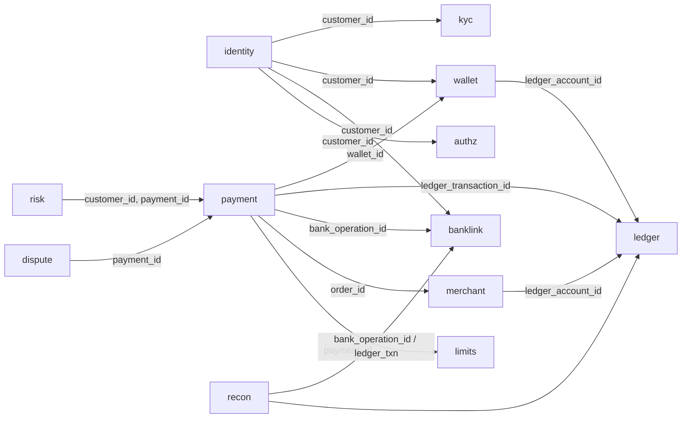

| Schema | Bảng | Owner module |
|---|---|---|
| `identity` | customers, phone_verifications, devices, credentials, refresh_tokens, consents | identity |
| `kyc` | sessions, documents, checks, verified_identities | kyc |
| `wallet` | wallets, status_history | wallet |
| `ledger` | accounts, transactions, entries, holds | ledger |
| `limits` | usage, consumptions | limit |
| `authz` | challenges | authz |
| `payment` | payments, status_history, wallet_activities | payment |
| `banklink` | links, operations, operation_attempts | banklink |
| `merchant` | merchants, api_keys, orders, refunds, callback_deliveries | merchant |
| `recon` | runs, items, adjustments | reconciliation |
| `risk` | aml_alerts | risk |
| `dispute` | disputes | dispute |
| `notification` | notifications | notification |
| `audit` | audit_logs | audit |
| `backoffice` | staff_users, staff_sessions | backoffice |
| `platform` | settings, outbox_events, processed_events, idempotency_keys, job_runs | platform |

---

## 3. Mô hình kế toán

### 3.1. Tài khoản ledger

Ledger được nhìn từ góc độ **công ty ví**. Tiền của khách trong ví là **nợ phải trả** của công ty; tiền nằm ở TK đảm bảo tại ngân hàng là **tài sản**.

| Code | Type | Normal side | `allow_negative` | Số lượng | Ý nghĩa | BR |
|---|---|---|---|---|---|---|
| `SAFEGUARD_BANK` | ASSET | DEBIT | false | 1 | Phản chiếu TK đảm bảo tại corebank | BR-55 |
| `WALLET:<wallet_id>` | LIABILITY | CREDIT | **false** | 1 / ví | Số dư **khả dụng** của ví | BR-24 |
| `WALLET_HOLD` | LIABILITY | CREDIT | false | 1 | Tổng tiền đang giữ chỗ cho payout/interbank | BR-50 |
| `MERCHANT_PAYABLE:<merchant_id>` | LIABILITY | CREDIT | false | 1 / merchant | Công ty ví nợ merchant (quyết toán merchant ngoài MVP) | BR-57 |
| `FEE_REVENUE` | REVENUE | CREDIT | false | 1 | Doanh thu phí (MVP = 0) | BR-30 |
| `RECON_SUSPENSE` | LIABILITY | CREDIT | **true** | 1 | Treo chênh lệch đối soát chưa thu hồi được | BR-58 |

`balance` được lưu **dương theo normal side**:

- DEBIT-normal: `balance = Σdebit − Σcredit`.
- CREDIT-normal: `balance = Σcredit − Σdebit`.

Hold được ghi bằng **bút toán thật** (chuyển từ `WALLET:<id>` sang `WALLET_HOLD`), nên:

- `WALLET:<id>.balance` chính là số dư khả dụng.
- Số dư hiển thị của ví = khả dụng + Σ hold `ACTIVE` của ví đó (lấy từ `ledger.holds`).
- Mọi thay đổi đều có bút toán, kiểm toán được.

### 3.2. Ma trận bút toán

Mỗi dòng là một `ledger.transactions`, các entries cân bằng với nhau.

| # | Sự kiện | Debit | Credit | Ghi chú |
|---|---|---|---|---|
| 1 | Nạp tiền — corebank xác nhận | `SAFEGUARD_BANK` | `WALLET:A` | Chỉ ghi khi đã xác nhận (BR-49) |
| 2 | Chuyển ví–ví | `WALLET:A` | `WALLET:B` | Đồng bộ, 1 transaction (BR-47) |
| 3a | Rút / interbank — tạo lệnh (hold) | `WALLET:A` | `WALLET_HOLD` | Tạo `ledger.holds` ACTIVE |
| 3b | ↳ corebank xác nhận thành công | `WALLET_HOLD` | `SAFEGUARD_BANK` | Hold → `CAPTURED` |
| 3c | ↳ corebank từ chối chắc chắn | `WALLET_HOLD` | `WALLET:A` | Hold → `RELEASED` (BR-50) |
| 4 | Thanh toán QR | `WALLET:A` | `MERCHANT_PAYABLE:M` | (BR-51) |
| 5 | Hoàn tiền QR | `MERCHANT_PAYABLE:M` | `WALLET:A` | ≤ số đã thanh toán (BR-48) |
| 6 | Phí (tương lai) | `WALLET:A` | `FEE_REVENUE` | MVP không phát sinh |
| 7a | Đối soát: NH đã ghi nợ, ví chưa ghi có | `SAFEGUARD_BANK` | `WALLET:A` | Hoàn tất topup bị kẹt (BR-58) |
| 7b | Đối soát: ví đã ghi có, NH không ghi nợ — ví đủ tiền | `WALLET:A` | `SAFEGUARD_BANK` | Bút toán đảo |
| 7c | ↳ ví không đủ tiền (đã tiêu) | `WALLET:A` (phần còn lại) + `RECON_SUSPENSE` (phần thiếu) | `SAFEGUARD_BANK` | Ví → `SUSPENDED`, tạo case thu hồi |

**Bất biến** (kiểm tra hằng ngày, BR-56):

```text
corebank.safeguard.balance  ==  ledger SAFEGUARD_BANK.balance                      (đối soát)
ledger SAFEGUARD_BANK.balance  ==  Σ WALLET:* + WALLET_HOLD + Σ MERCHANT_PAYABLE:* + FEE_REVENUE + RECON_SUSPENSE
                                                                                   (phương trình kế toán)
⇒ TK đảm bảo ≥ tổng số dư (kể cả hold) mọi ví
```

---

## 4. Schema chi tiết

### 4.1. `identity`

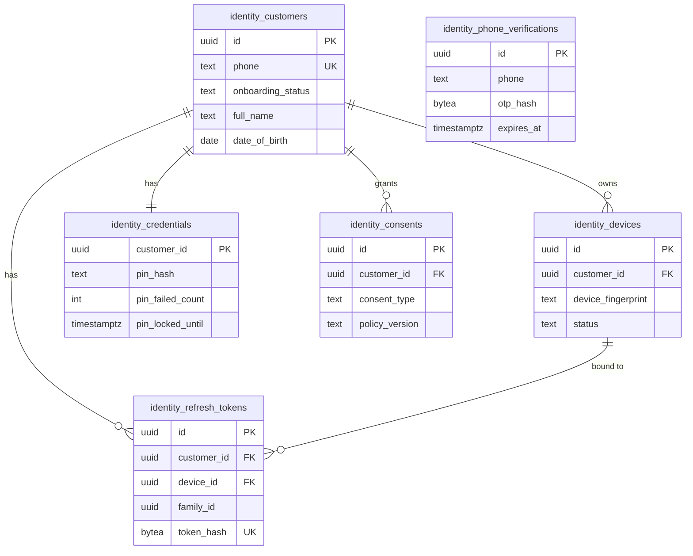

**`identity.customers`**

| Cột | Kiểu | Ràng buộc | Ghi chú |
|---|---|---|---|
| id | UUID | PK | |
| phone | TEXT | UK | E.164, ví dụ `+849…` (BR-03) |
| phone_verified_at | TIMESTAMPTZ | | |
| onboarding_status | TEXT | CHECK IN (`REGISTERED`,`KYC_PENDING`,`KYC_VERIFIED`,`KYC_REJECTED`,`MANUAL_REVIEW`) | BR-06 |
| full_name | TEXT | NULL | Lấy từ eKYC sau khi verified; dùng để hiển thị |
| date_of_birth | DATE | NULL | Kiểm tra tuổi ≥ 18 (BR-01) |
| closed_at | TIMESTAMPTZ | NULL | |
| created_at, updated_at, version | | | |

**`identity.phone_verifications`** — OTP khi đăng ký và khi đổi số.

| Cột | Kiểu | Ràng buộc | Ghi chú |
|---|---|---|---|
| id | UUID | PK | |
| phone | TEXT | | |
| purpose | TEXT | CHECK IN (`REGISTER`,`CHANGE_PHONE`,`NEW_DEVICE`) | |
| otp_hash | BYTEA | | Không lưu OTP rõ |
| attempts | INT | DEFAULT 0, CHECK ≤ 5 | |
| expires_at | TIMESTAMPTZ | | 5 phút |
| verified_at | TIMESTAMPTZ | NULL | |

**`identity.devices`**

| Cột | Kiểu | Ràng buộc | Ghi chú |
|---|---|---|---|
| id | UUID | PK | = `X-Device-Id` |
| customer_id | UUID | FK customers | |
| device_fingerprint | TEXT | | Do app sinh và lưu trong secure storage |
| platform, model, app_version | TEXT | | |
| status | TEXT | CHECK IN (`ACTIVE`,`REVOKED`) | |
| bound_at | TIMESTAMPTZ | | Dùng để áp hạn mức 24h đầu (BR-38) |
| revoked_at | TIMESTAMPTZ | NULL | |

Index: `UNIQUE (customer_id) WHERE status = 'ACTIVE'` → mỗi khách hàng chỉ 1 thiết bị active (BR-38).

**`identity.credentials`**

| Cột | Kiểu | Ràng buộc | Ghi chú |
|---|---|---|---|
| customer_id | UUID | PK, FK customers | |
| pin_hash | TEXT | NULL | argon2id (PHC string) |
| pin_failed_count | INT | DEFAULT 0 | BR-39 |
| pin_locked_until | TIMESTAMPTZ | NULL | |
| pin_hard_locked | BOOLEAN | DEFAULT false | Phải reset PIN bằng OTP + khuôn mặt |
| pin_updated_at | TIMESTAMPTZ | NULL | |
| version | INT | | |

**`identity.refresh_tokens`**

| Cột | Kiểu | Ràng buộc | Ghi chú |
|---|---|---|---|
| id | UUID | PK | |
| customer_id | UUID | FK | |
| device_id | UUID | FK devices | |
| family_id | UUID | | Dùng lại token cũ → thu hồi cả family |
| token_hash | BYTEA | UK | SHA-256 của token opaque |
| replaced_by | UUID | NULL, FK refresh_tokens | |
| expires_at | TIMESTAMPTZ | | 30 ngày |
| revoked_at | TIMESTAMPTZ | NULL | |

**`identity.consents`** (BR-70)

| Cột | Kiểu | Ràng buộc | Ghi chú |
|---|---|---|---|
| id | UUID | PK | |
| customer_id | UUID | FK | |
| consent_type | TEXT | CHECK IN (`TERMS`,`PERSONAL_DATA`,`BIOMETRIC_DATA`,`DATA_SHARING_BANK`) | Đồng ý sinh trắc tách riêng |
| policy_version | TEXT | | Phiên bản điều khoản |
| granted_at | TIMESTAMPTZ | | |
| withdrawn_at | TIMESTAMPTZ | NULL | |
| ip, user_agent | TEXT | NULL | Bằng chứng đồng ý |

### 4.2. `kyc`

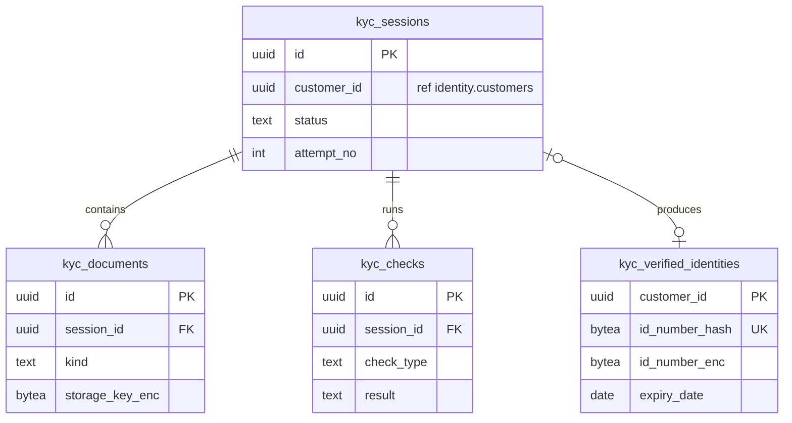

**`kyc.sessions`**

| Cột | Kiểu | Ràng buộc | Ghi chú |
|---|---|---|---|
| id | UUID | PK | |
| customer_id | UUID | ref identity.customers | |
| purpose | TEXT | CHECK IN (`ONBOARDING`,`RE_KYC`,`NEW_DEVICE`) | eKYC lại khi CCCD hết hạn (BR-07) |
| status | TEXT | xem §6 | |
| attempt_no | INT | | Tối đa 3 lần/ngày (BR-06) |
| reject_reason | TEXT | NULL | Mã lý do |
| expires_at | TIMESTAMPTZ | | Phiên hết hạn sau 30 phút |
| decided_by | UUID | NULL, ref backoffice.staff_users | Khi `MANUAL_REVIEW` |
| created_at, updated_at, version | | | |

Index: `(customer_id, created_at DESC)`.

**`kyc.documents`**

| Cột | Kiểu | Ràng buộc | Ghi chú |
|---|---|---|---|
| id | UUID | PK | |
| session_id | UUID | FK sessions | |
| kind | TEXT | CHECK IN (`ID_FRONT`,`ID_BACK`,`SELFIE`,`LIVENESS_VIDEO`,`CHIP_DATA`) | |
| storage_key_enc | BYTEA | | Key object trên MinIO (mã hóa) |
| sha256 | BYTEA | | Toàn vẹn file |
| mime_type | TEXT | | Theo magic bytes, không theo header |
| size_bytes | INT | CHECK ≤ 10 MB | |

UK `(session_id, kind)`.

**`kyc.checks`** — kết quả từng provider, lưu đủ lịch sử (không ghi đè).

| Cột | Kiểu | Ràng buộc | Ghi chú |
|---|---|---|---|
| id | UUID | PK | |
| session_id | UUID | FK | |
| check_type | TEXT | CHECK IN (`OCR`,`LIVENESS`,`FACE_MATCH`,`CHIP_VERIFY`,`AGE`,`DUPLICATE_ID`) | |
| provider | TEXT | | `mock-ocr`… |
| attempt | INT | | |
| result | TEXT | CHECK IN (`PASS`,`FAIL`,`ERROR`) | `ERROR` = lỗi kỹ thuật, retry được |
| score | NUMERIC(5,4) | NULL | |
| error_code | TEXT | NULL | |
| provider_ref | TEXT | NULL | |
| created_at | TIMESTAMPTZ | | |

**`kyc.verified_identities`** — dữ liệu định danh đã xác minh (nhạy cảm, BR-71).

| Cột | Kiểu | Ràng buộc | Ghi chú |
|---|---|---|---|
| customer_id | UUID | PK, ref identity.customers | |
| session_id | UUID | FK sessions | Phiên đã xác minh |
| id_number_hash | BYTEA | **UK** | 1 CCCD chỉ gắn 1 khách hàng |
| id_number_enc | BYTEA | | |
| full_name_enc, date_of_birth_enc, address_enc | BYTEA | | |
| gender | TEXT | | |
| issue_date, expiry_date | DATE | | `expiry_date` dùng cho job BR-07 |
| face_template_enc | BYTEA | | Dùng cho face match khi step-up |
| verified_at | TIMESTAMPTZ | | |
| expiry_notified_at | TIMESTAMPTZ | NULL | Đã gửi báo trước 30 ngày |

Index: `(expiry_date)`.

### 4.3. `wallet`

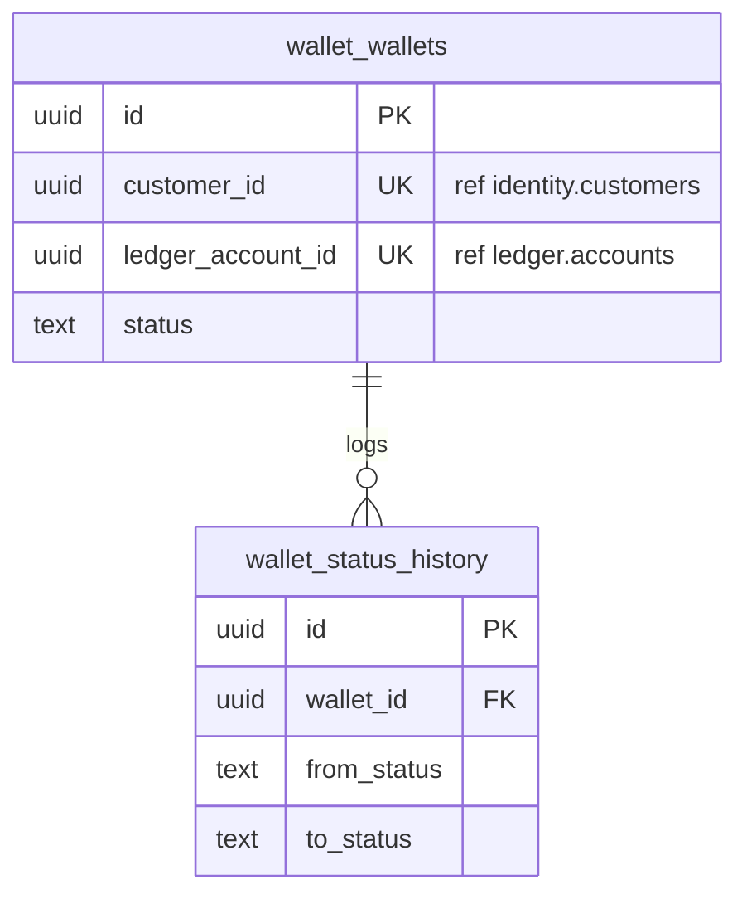

**`wallet.wallets`**

| Cột | Kiểu | Ràng buộc | Ghi chú |
|---|---|---|---|
| id | UUID | PK | |
| customer_id | UUID | UK, ref identity.customers | 1 ví / khách hàng (BR-02) |
| ledger_account_id | UUID | UK, ref ledger.accounts | Tài khoản `WALLET:<id>` |
| currency | CHAR(3) | DEFAULT `VND` | |
| status | TEXT | CHECK IN (`INACTIVE`,`ACTIVE`,`SUSPENDED`,`FROZEN`,`CLOSED`) | §6 |
| status_reason | TEXT | NULL | `ID_EXPIRED`, `FRAUD_SUSPECTED`, `CUSTOMER_REQUEST`, `DORMANT`… |
| last_activity_at | TIMESTAMPTZ | NULL | Dùng cho BR-63 |
| dormant_notified_at | TIMESTAMPTZ | NULL | |
| closed_at | TIMESTAMPTZ | NULL | |
| created_at, updated_at, version | | | |

Index: `(status, last_activity_at)`, phục vụ job ví không hoạt động.

**`wallet.status_history`** (append-only): `id`, `wallet_id` FK, `from_status`, `to_status`, `reason`, `actor_type` (`SYSTEM`/`CUSTOMER`/`STAFF`), `actor_id NULL`, `request_id`, `created_at`.

### 4.4. `ledger`

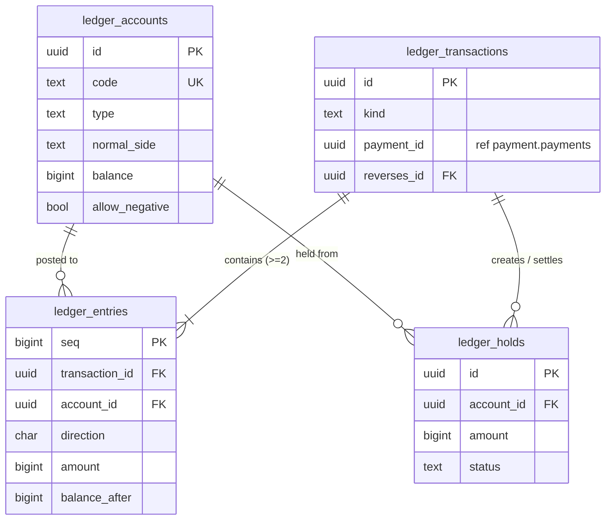

**`ledger.accounts`**

| Cột | Kiểu | Ràng buộc | Ghi chú |
|---|---|---|---|
| id | UUID | PK | |
| code | TEXT | UK | `SAFEGUARD_BANK`, `WALLET:<uuid>`, … |
| type | TEXT | CHECK IN (`ASSET`,`LIABILITY`,`REVENUE`,`EXPENSE`) | |
| normal_side | CHAR(1) | CHECK IN (`D`,`C`) | |
| owner_type | TEXT | CHECK IN (`SYSTEM`,`WALLET`,`MERCHANT`) | |
| owner_id | UUID | NULL | ref wallet/merchant |
| currency | CHAR(3) | | |
| balance | BIGINT | DEFAULT 0 | Dương theo normal side |
| allow_negative | BOOLEAN | DEFAULT false | |
| status | TEXT | CHECK IN (`OPEN`,`CLOSED`) | |
| version | INT | | |

Constraint: `CHECK (allow_negative OR balance >= 0)`. Đây là chốt chặn cuối của BR-24.

**`ledger.transactions`** (append-only)

| Cột | Kiểu | Ràng buộc | Ghi chú |
|---|---|---|---|
| id | UUID | PK | |
| kind | TEXT | CHECK IN (`TOPUP`,`TRANSFER`,`HOLD`,`HOLD_CAPTURE`,`HOLD_RELEASE`,`QR_PAYMENT`,`REFUND`,`FEE`,`ADJUSTMENT`,`REVERSAL`) | Theo ma trận §3.2 |
| payment_id | UUID | NULL, ref payment.payments | |
| adjustment_id | UUID | NULL, ref recon.adjustments | |
| reverses_id | UUID | NULL, FK transactions, UK | Một transaction chỉ bị đảo tối đa 1 lần |
| description | TEXT | | |
| effective_date | DATE | | Ngày nghiệp vụ (giờ VN) |
| created_at | TIMESTAMPTZ | | |

**`ledger.entries`** (append-only)

| Cột | Kiểu | Ràng buộc | Ghi chú |
|---|---|---|---|
| seq | BIGINT | PK, identity | Thứ tự ghi toàn cục |
| transaction_id | UUID | FK transactions | |
| account_id | UUID | FK accounts | |
| direction | CHAR(1) | CHECK IN (`D`,`C`) | |
| amount | BIGINT | CHECK > 0 | |
| currency | CHAR(3) | | Trigger kiểm tra khớp với account |
| balance_after | BIGINT | | Số dư account sau entry; phục vụ sao kê và phát hiện drift |
| created_at | TIMESTAMPTZ | | |

Index: `(account_id, seq DESC)` cho sao kê; `(transaction_id)`.

**`ledger.holds`**

| Cột | Kiểu | Ràng buộc | Ghi chú |
|---|---|---|---|
| id | UUID | PK | |
| account_id | UUID | FK accounts | Tài khoản ví bị giữ tiền |
| payment_id | UUID | UK, ref payment.payments | 1 hold / payment |
| amount | BIGINT | CHECK > 0 | |
| status | TEXT | CHECK IN (`ACTIVE`,`CAPTURED`,`RELEASED`) | |
| hold_txn_id | UUID | FK transactions | Bút toán 3a |
| settle_txn_id | UUID | NULL, FK transactions | Bút toán 3b hoặc 3c |
| created_at, updated_at, version | | | |

Index: `(account_id) WHERE status = 'ACTIVE'`.

**Trigger ép bất biến** (SQL mẫu cho migration):

```sql
-- 1. Append-only
CREATE FUNCTION ledger.forbid_mutation() RETURNS trigger AS $$
BEGIN
  RAISE EXCEPTION 'ledger.% is append-only', TG_TABLE_NAME;
END $$ LANGUAGE plpgsql;

CREATE TRIGGER entries_immutable BEFORE UPDATE OR DELETE ON ledger.entries
  FOR EACH ROW EXECUTE FUNCTION ledger.forbid_mutation();
CREATE TRIGGER transactions_immutable BEFORE UPDATE OR DELETE ON ledger.transactions
  FOR EACH ROW EXECUTE FUNCTION ledger.forbid_mutation();

-- 2. Σdebit = Σcredit cho mỗi transaction, kiểm tra lúc COMMIT
CREATE FUNCTION ledger.check_txn_balanced() RETURNS trigger AS $$
DECLARE d BIGINT; c BIGINT;
BEGIN
  SELECT COALESCE(SUM(amount) FILTER (WHERE direction = 'D'), 0),
         COALESCE(SUM(amount) FILTER (WHERE direction = 'C'), 0)
    INTO d, c
    FROM ledger.entries
   WHERE transaction_id = NEW.transaction_id;
  IF d <> c THEN
    RAISE EXCEPTION 'ledger transaction % unbalanced: D=% C=%', NEW.transaction_id, d, c;
  END IF;
  RETURN NULL;
END $$ LANGUAGE plpgsql;

CREATE CONSTRAINT TRIGGER entries_balanced
  AFTER INSERT ON ledger.entries
  DEFERRABLE INITIALLY DEFERRED
  FOR EACH ROW EXECUTE FUNCTION ledger.check_txn_balanced();

-- 3. currency của entry khớp account
CREATE FUNCTION ledger.check_entry_currency() RETURNS trigger AS $$
BEGIN
  IF NEW.currency <> (SELECT currency FROM ledger.accounts WHERE id = NEW.account_id) THEN
    RAISE EXCEPTION 'currency mismatch for account %', NEW.account_id;
  END IF;
  RETURN NEW;
END $$ LANGUAGE plpgsql;

CREATE TRIGGER entries_currency BEFORE INSERT ON ledger.entries
  FOR EACH ROW EXECUTE FUNCTION ledger.check_entry_currency();
```

Ghi chú:

- Việc cập nhật `accounts.balance` và tính `balance_after` do **app** làm trong cùng transaction, sau khi đã `SELECT … FOR UPDATE` các account theo thứ tự id tăng dần.
- `CHECK` của `accounts` chặn số dư âm.
- Transaction không có entry nào thì không bị trigger bắt; app luôn insert ít nhất 2 entries. Job drift (§7) phát hiện các trường hợp còn sót.

### 4.5. `limits`

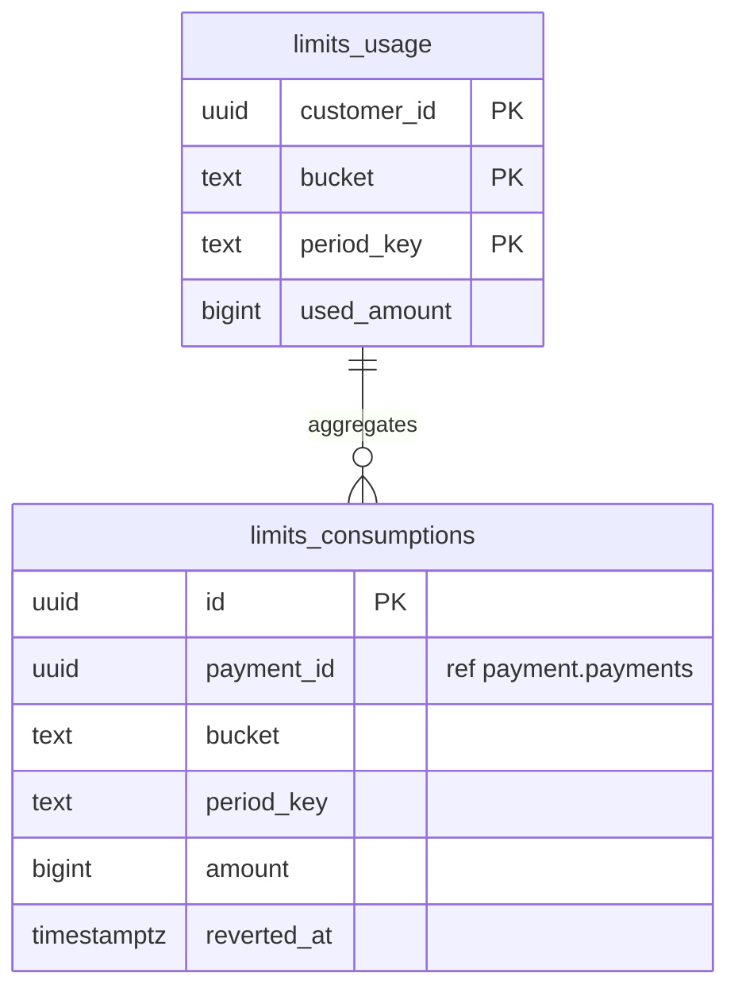

**`limits.usage`** — bộ đếm, bị lock (`FOR UPDATE`) trong transaction tiền (BR-29).

| Cột | Kiểu | Ràng buộc | Ghi chú |
|---|---|---|---|
| customer_id | UUID | PK (1/3), ref identity.customers | |
| bucket | TEXT | PK (2/3), CHECK IN (`MONTH_GENERAL`,`MONTH_ESSENTIAL`,`DAY_OWN_ACCOUNT`,`DAY_OTHER`) | |
| period_key | TEXT | PK (3/3) | `2026-10` (tháng) hoặc `2026-10-17` (ngày), giờ VN (BR-27) |
| used_amount | BIGINT | CHECK ≥ 0 | |
| txn_count | INT | | |
| version, updated_at | | | |

Các bucket:

| Bucket | Dùng cho | Cách kiểm tra |
|---|---|---|
| `MONTH_GENERAL` | Hạn mức 100 tr/tháng (BR-25) | `used + amount ≤ limit.monthly_general` |
| `MONTH_ESSENTIAL` | Phần cộng thêm cho dịch vụ thiết yếu (BR-26) | `GENERAL + ESSENTIAL ≤ limit.monthly_with_essential` |
| `DAY_OWN_ACCOUNT` | Tổng T trong ngày cho nạp/rút với TK chính chủ (BR-37) | Dùng cho step-up BR-36 |
| `DAY_OTHER` | Tổng T trong ngày cho các giao dịch còn lại (BR-37) | Dùng cho step-up BR-36 |

**`limits.consumptions`** — mỗi lần tiêu hạn mức là 1 dòng; dùng để hoàn hạn mức một cách idempotent khi giao dịch thất bại hoặc bị đảo.

| Cột | Kiểu | Ràng buộc | Ghi chú |
|---|---|---|---|
| id | UUID | PK | |
| payment_id | UUID | ref payment.payments | |
| customer_id, bucket, period_key | | FK → usage | |
| amount | BIGINT | CHECK > 0 | |
| reverted_at | TIMESTAMPTZ | NULL | Set khi hoàn hạn mức; không set 2 lần |
| created_at | TIMESTAMPTZ | | |

UK `(payment_id, bucket)`.

### 4.6. `authz`

**`authz.challenges`** (BR-36, BR-40)

| Cột | Kiểu | Ràng buộc | Ghi chú |
|---|---|---|---|
| id | UUID | PK | `challenge_id` |
| customer_id | UUID | ref identity.customers | |
| device_id | UUID | ref identity.devices | |
| purpose | TEXT | CHECK IN (`TRANSACTION`,`NEW_DEVICE`,`PIN_RESET`,`CHANGE_PHONE`) | |
| intent_hash | BYTEA | | SHA-256 của (type, amount, recipient, idempotency_key); không khớp thì từ chối |
| required_methods | TEXT[] | | `{OTP,FACE}` |
| completed_methods | TEXT[] | DEFAULT `{}` | |
| otp_hash | BYTEA | NULL | |
| attempts | INT | CHECK ≤ 5 | |
| status | TEXT | CHECK IN (`PENDING`,`VERIFIED`,`CONSUMED`,`EXPIRED`,`FAILED`) | Dùng một lần: `VERIFIED → CONSUMED` |
| expires_at | TIMESTAMPTZ | | TTL 5 phút |
| consumed_at | TIMESTAMPTZ | NULL | |
| created_at, version | | | |

Đếm số lần sai PIN nằm ở `identity.credentials` (PIN là credential của khách hàng).

### 4.7. `payment`

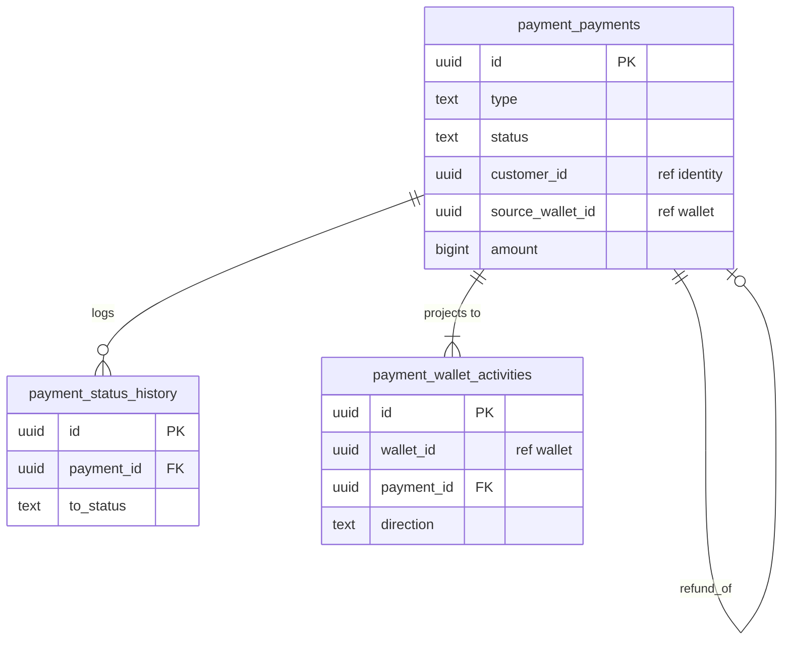

**`payment.payments`**

| Cột | Kiểu | Ràng buộc | Ghi chú |
|---|---|---|---|
| id | UUID | PK | `transaction_id` public (`txn_…`) |
| type | TEXT | CHECK IN (`TOPUP`,`TRANSFER`,`WITHDRAW`,`INTERBANK`,`QR_PAYMENT`,`REFUND`,`ADJUSTMENT`) | |
| status | TEXT | CHECK IN (`CREATED`,`PENDING`,`SUCCEEDED`,`FAILED`,`NEEDS_RECONCILIATION`,`REVERSED`) | §6 (BR-45) |
| customer_id | UUID | ref identity.customers | Người khởi tạo (refund: chủ ví nhận) |
| source_wallet_id | UUID | NULL, ref wallet.wallets | |
| dest_wallet_id | UUID | NULL, ref wallet.wallets | TRANSFER, TOPUP, REFUND |
| bank_link_id | UUID | NULL, ref banklink.links | TOPUP, WITHDRAW |
| dest_bank_code, dest_account_masked | TEXT | NULL | INTERBANK |
| dest_account_enc, dest_holder_name | BYTEA / TEXT | NULL | INTERBANK |
| merchant_id, order_id | UUID | NULL, ref merchant | QR_PAYMENT, REFUND |
| refund_of_id | UUID | NULL, FK payments | REFUND |
| amount | BIGINT | CHECK > 0 | |
| fee | BIGINT | DEFAULT 0, CHECK ≥ 0 | BR-30 |
| currency | CHAR(3) | | |
| description | TEXT | NULL | Nội dung chuyển |
| limit_category | TEXT | CHECK IN (`NONE`,`GENERAL`,`ESSENTIAL`) | Bucket hạn mức đã dùng (BR-25/26) |
| auth_level | TEXT | CHECK IN (`PIN`,`OTP_FACE`) | Cấp xác thực đã dùng (BR-35/36) |
| challenge_id | UUID | NULL, ref authz.challenges | |
| ledger_txn_id | UUID | NULL, ref ledger.transactions | Bút toán chính |
| bank_operation_id | UUID | NULL, ref banklink.operations | |
| failure_code | TEXT | NULL | `INSUFFICIENT_FUNDS`, `LIMIT_EXCEEDED`, `BANK_REJECTED_*`… |
| idempotency_key | TEXT | | |
| request_id | TEXT | | Correlation |
| pending_since | TIMESTAMPTZ | NULL | Phục vụ BR-46 (24h) |
| completed_at | TIMESTAMPTZ | NULL | |
| created_at, updated_at, version | | | |

Index:

- UK `(customer_id, idempotency_key)`.
- `(status, pending_since) WHERE status IN ('PENDING','NEEDS_RECONCILIATION')`.
- `(order_id) WHERE type = 'QR_PAYMENT' AND status = 'SUCCEEDED'` **UNIQUE** → chống thanh toán trùng đơn (BR-51).

Ghi chú: chuyển ví–ví bị từ chối vì lỗi nghiệp vụ (thiếu tiền, vượt hạn mức) thì transaction rollback, **không lưu payment**. Response lỗi được lưu trong `platform.idempotency_keys` để request lặp lại nhận cùng kết quả.

**`payment.status_history`** (append-only): `id`, `payment_id` FK, `from_status`, `to_status`, `reason_code`, `actor_type`, `actor_id NULL`, `request_id`, `created_at`.

**`payment.wallet_activities`** — read-model cho lịch sử (architecture §4.3).

| Cột | Kiểu | Ràng buộc | Ghi chú |
|---|---|---|---|
| id | UUID | PK | |
| wallet_id | UUID | ref wallet.wallets | |
| payment_id | UUID | FK payments | |
| direction | TEXT | CHECK IN (`IN`,`OUT`) | |
| type | TEXT | | Copy từ payment |
| amount | BIGINT | | |
| status | TEXT | | Đồng bộ khi payment đổi trạng thái (cùng transaction) |
| counterparty_display | TEXT | | Tên đã che / tên merchant / ngân hàng + 4 số cuối |
| description | TEXT | NULL | |
| occurred_at | TIMESTAMPTZ | | |

UK `(payment_id, wallet_id, direction)`. Index `(wallet_id, occurred_at DESC, id DESC)` cho phân trang keyset.

### 4.8. `banklink`

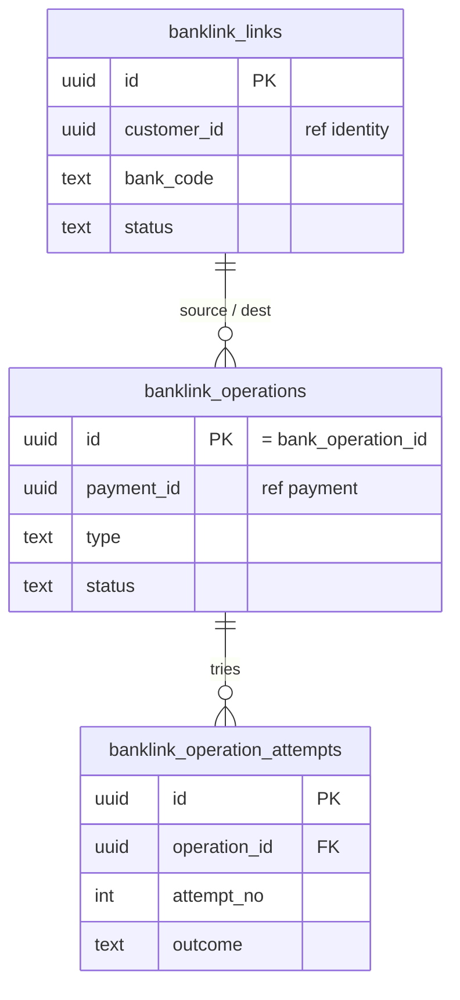

**`banklink.links`** (BR-10…14)

| Cột | Kiểu | Ràng buộc | Ghi chú |
|---|---|---|---|
| id | UUID | PK | |
| customer_id | UUID | ref identity.customers | |
| bank_code | TEXT | | |
| source_type | TEXT | CHECK IN (`ACCOUNT`,`DEBIT_CARD`) | Không có `CREDIT_CARD` (BR-11) |
| number_hash | BYTEA | | Tra cứu trùng |
| number_enc | BYTEA | | |
| number_masked | TEXT | | `****1234` |
| holder_name | TEXT | | Đã khớp với CCCD |
| corebank_link_id | TEXT | NULL | |
| link_token_enc | BYTEA | NULL | Token corebank trả về |
| status | TEXT | CHECK IN (`PENDING`,`OTP_SENT`,`VERIFIED`,`FAILED`,`REVOKED`) | |
| is_default | BOOLEAN | DEFAULT false | |
| verified_at, revoked_at | TIMESTAMPTZ | NULL | |
| created_at, updated_at, version | | | |

Index:

- UK `(customer_id, bank_code, number_hash) WHERE status <> 'REVOKED'`.
- UK `(customer_id) WHERE is_default`.

Giới hạn tối đa 3 link `VERIFIED`/khách hàng (BR-12) và quy tắc "không được hủy link cuối cùng" (BR-13) do app kiểm tra, với lock trên các link của khách hàng.

**`banklink.operations`** — mỗi lệnh gửi corebank (BR-49).

| Cột | Kiểu | Ràng buộc | Ghi chú |
|---|---|---|---|
| id | UUID | PK | = `bank_operation_id` gửi corebank, **ổn định qua mọi retry** |
| payment_id | UUID | ref payment.payments | |
| type | TEXT | CHECK IN (`DEBIT_TO_SAFEGUARD`,`CREDIT_FROM_SAFEGUARD`,`INTERBANK_TRANSFER`) | |
| link_id | UUID | NULL, FK links | |
| amount | BIGINT | CHECK > 0 | |
| request_payload | JSONB | | Payload cố định, gửi lại y hệt khi retry |
| status | TEXT | CHECK IN (`PENDING`,`SENT`,`SUCCEEDED`,`REJECTED`,`UNKNOWN`,`NEEDS_RECONCILIATION`) | §6 |
| corebank_ref | TEXT | NULL | |
| reason_code | TEXT | NULL | |
| attempts | INT | DEFAULT 0 | |
| next_attempt_at | TIMESTAMPTZ | NULL | |
| first_sent_at, resolved_at | TIMESTAMPTZ | NULL | |
| created_at, updated_at, version | | | |

Index: UK `(payment_id, type)`; `(status, next_attempt_at) WHERE status IN ('PENDING','SENT','UNKNOWN')`.

**`banklink.operation_attempts`** (append-only): `id`, `operation_id` FK, `attempt_no`, `kind` (`SUBMIT`/`QUERY`), `http_status NULL`, `outcome` (`SUCCEEDED`/`REJECTED`/`PROCESSING`/`TIMEOUT`/`NETWORK_ERROR`/`SERVER_ERROR`), `latency_ms`, `error`, `created_at`.

### 4.9. `merchant`

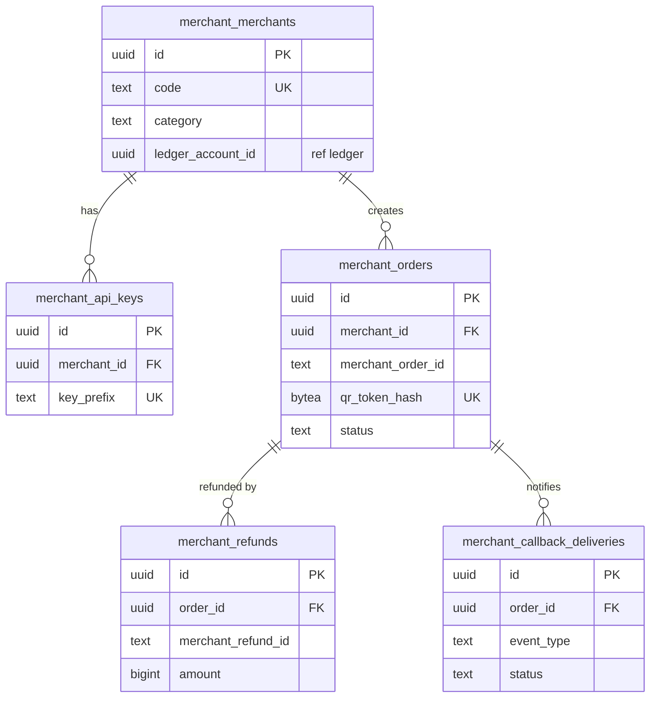

**`merchant.merchants`** (BR-53)

| Cột | Kiểu | Ràng buộc | Ghi chú |
|---|---|---|---|
| id | UUID | PK | |
| code | TEXT | UK | |
| legal_name, display_name | TEXT | | |
| category | TEXT | CHECK IN (`GENERAL`,`ESSENTIAL`) | Quyết định bucket hạn mức (BR-26) |
| status | TEXT | CHECK IN (`ACTIVE`,`SUSPENDED`,`TERMINATED`) | |
| callback_url | TEXT | | |
| ledger_account_id | UUID | UK, ref ledger.accounts | `MERCHANT_PAYABLE:<id>` |
| created_at, updated_at, version | | | |

**`merchant.api_keys`**: `id`, `merchant_id` FK, `key_prefix` UK (8 ký tự đầu, để tra cứu), `key_hash`, `hmac_secret_enc`, `status` (`ACTIVE`/`REVOKED`), `created_at`, `revoked_at NULL`.

**`merchant.orders`**

| Cột | Kiểu | Ràng buộc | Ghi chú |
|---|---|---|---|
| id | UUID | PK | |
| merchant_id | UUID | FK merchants | |
| merchant_order_id | TEXT | | Mã đơn của merchant |
| amount | BIGINT | CHECK > 0 | |
| currency | CHAR(3) | | |
| description | TEXT | | |
| qr_token_hash | BYTEA | UK | Token 128-bit; chỉ lưu hash (BR-52) |
| status | TEXT | CHECK IN (`CREATED`,`PAID`,`EXPIRED`,`CANCELLED`,`PARTIALLY_REFUNDED`,`REFUNDED`) | §6 |
| expires_at | TIMESTAMPTZ | | +15 phút |
| paid_payment_id | UUID | NULL, ref payment.payments | |
| paid_at | TIMESTAMPTZ | NULL | |
| refunded_amount | BIGINT | DEFAULT 0, CHECK `refunded_amount <= amount` | |
| created_at, updated_at, version | | | |

Index: UK `(merchant_id, merchant_order_id)` (BR-51); `(status, expires_at) WHERE status = 'CREATED'`.

**`merchant.refunds`**: `id`, `order_id` FK, `merchant_refund_id`, `amount` CHECK > 0, `payment_id` (ref payment, REFUND), `status` (`PENDING`/`SUCCEEDED`/`FAILED`), `created_at`. UK `(order_id, merchant_refund_id)`.

**`merchant.callback_deliveries`**: `id`, `order_id` FK, `event_type` (`order.paid`/`order.refunded`), `event_id` (ref platform.outbox_events), `status` (`PENDING`/`DELIVERED`/`GAVE_UP`), `attempts`, `last_http_status NULL`, `last_error NULL`, `next_attempt_at`, `deadline_at` (+24h, BR-51), `delivered_at NULL`.

### 4.10. `recon`

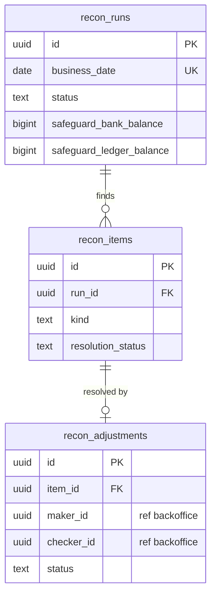

**`recon.runs`** (BR-56, BR-58)

| Cột | Kiểu | Ràng buộc | Ghi chú |
|---|---|---|---|
| id | UUID | PK | |
| business_date | DATE | UK | Mỗi ngày 1 lần chạy (chạy lại thì cập nhật) |
| status | TEXT | CHECK IN (`RUNNING`,`COMPLETED`,`FAILED`) | |
| safeguard_bank_balance | BIGINT | NULL | Từ corebank |
| safeguard_ledger_balance | BIGINT | NULL | Từ ledger |
| total_liabilities | BIGINT | NULL | Σ WALLET + HOLD + MERCHANT_PAYABLE + … |
| invariant_ok | BOOLEAN | NULL | `safeguard_bank_balance >= total_liabilities` |
| matched_count, mismatch_count | INT | | |
| started_at, finished_at | TIMESTAMPTZ | | |

**`recon.items`**

| Cột | Kiểu | Ràng buộc | Ghi chú |
|---|---|---|---|
| id | UUID | PK | |
| run_id | UUID | FK runs | |
| kind | TEXT | CHECK IN (`MISSING_IN_WALLET`,`MISSING_IN_BANK`,`AMOUNT_MISMATCH`,`STATUS_MISMATCH`,`STUCK_PENDING`) | |
| bank_operation_id | UUID | NULL, ref banklink.operations | |
| corebank_ref | TEXT | NULL | |
| payment_id | UUID | NULL, ref payment.payments | |
| wallet_amount, bank_amount | BIGINT | NULL | |
| resolution_status | TEXT | CHECK IN (`OPEN`,`AUTO_RESOLVED`,`ADJUSTMENT_PENDING`,`RESOLVED`,`WRITTEN_OFF`) | |
| notes | TEXT | NULL | |

**`recon.adjustments`** — maker–checker (BR-64)

| Cột | Kiểu | Ràng buộc | Ghi chú |
|---|---|---|---|
| id | UUID | PK | |
| item_id | UUID | NULL, FK items | Có thể điều chỉnh không gắn item (khiếu nại) |
| dispute_id | UUID | NULL, ref dispute.disputes | |
| type | TEXT | CHECK IN (`COMPENSATE_CREDIT`,`REVERSAL`,`SUSPENSE_RECOVERY`) | Ma trận §3.2 dòng 7 |
| wallet_id | UUID | ref wallet.wallets | |
| amount | BIGINT | CHECK > 0 | |
| reason | TEXT | NOT NULL, CHECK `length(reason) >= 10` | Bắt buộc ghi lý do |
| maker_id | UUID | ref backoffice.staff_users | |
| checker_id | UUID | NULL | |
| status | TEXT | CHECK IN (`DRAFT`,`PENDING_APPROVAL`,`APPROVED`,`REJECTED`,`POSTED`) | |
| ledger_txn_id | UUID | NULL, ref ledger.transactions | Set khi `POSTED` |
| created_at, decided_at, version | | | |

Constraint: `CHECK (checker_id IS NULL OR checker_id <> maker_id)`.

### 4.11. `risk`, `dispute`, `notification`

**`risk.aml_alerts`** (BR-61, BR-74)

| Cột | Kiểu | Ràng buộc | Ghi chú |
|---|---|---|---|
| id | UUID | PK | |
| rule_code | TEXT | CHECK IN (`EWIRE_THRESHOLD`,`TOPUP_THEN_DRAIN`,`FAN_IN`,`MANUAL`) | |
| customer_id | UUID | ref identity.customers | |
| payment_ids | UUID[] | | Các giao dịch liên quan |
| total_amount | BIGINT | | |
| window_start, window_end | TIMESTAMPTZ | | |
| status | TEXT | CHECK IN (`OPEN`,`REVIEWING`,`CLOSED_FALSE_POSITIVE`,`ESCALATED`,`REPORTED`) | |
| assignee_id | UUID | NULL, ref backoffice.staff_users | |
| action_taken | TEXT | NULL | `WALLET_SUSPENDED`… |
| notes | TEXT | NULL | |
| created_at, updated_at, version | | | |

UK `(rule_code, customer_id, window_start)` để không tạo trùng alert.

**`dispute.disputes`** (BR-60)

| Cột | Kiểu | Ràng buộc | Ghi chú |
|---|---|---|---|
| id | UUID | PK | Mã tra soát |
| customer_id | UUID | ref identity.customers | |
| payment_id | UUID | ref payment.payments | |
| type | TEXT | CHECK IN (`WRONG_RECIPIENT`,`NOT_RECEIVED`,`DUPLICATE_CHARGE`,`UNAUTHORIZED`,`OTHER`) | |
| description | TEXT | | |
| status | TEXT | CHECK IN (`SUBMITTED`,`IN_REVIEW`,`WAITING_CUSTOMER`,`RESOLVED_ACCEPTED`,`RESOLVED_REJECTED`) | |
| submitted_at | TIMESTAMPTZ | | App kiểm tra ≤ 60 ngày kể từ giao dịch |
| due_at | TIMESTAMPTZ | | + 15 ngày làm việc |
| resolution | TEXT | NULL | |
| adjustment_id | UUID | NULL, ref recon.adjustments | |
| handled_by | UUID | NULL, ref backoffice.staff_users | |
| created_at, updated_at, version | | | |

**`notification.notifications`**: `id`, `customer_id`, `channel` (`PUSH`/`SMS`), `template`, `payload JSONB` (không chứa PII nhạy cảm), `status` (`PENDING`/`SENT`/`FAILED`), `source_event_id` UK (idempotent), `sent_at NULL`, `created_at`.

### 4.12. `audit`

**`audit.audit_logs`** (append-only; role app chỉ có `INSERT`/`SELECT`)

| Cột | Kiểu | Ràng buộc | Ghi chú |
|---|---|---|---|
| id | UUID | PK | |
| occurred_at | TIMESTAMPTZ | | |
| actor_type | TEXT | CHECK IN (`CUSTOMER`,`STAFF`,`MERCHANT`,`SYSTEM`) | |
| actor_id | UUID | NULL | |
| action | TEXT | | `wallet.freeze`, `kyc.image.view`, `adjustment.approve`… |
| resource_type, resource_id | TEXT | | |
| outcome | TEXT | CHECK IN (`SUCCESS`,`DENIED`,`ERROR`) | |
| reason | TEXT | NULL | Bắt buộc với thao tác của staff |
| request_id, trace_id | TEXT | | |
| ip, user_agent | TEXT | NULL | |
| metadata | JSONB | | **Không** chứa CCCD, ảnh, OTP, PIN, token (BR-71) |

Index: `(resource_type, resource_id, occurred_at)`, `(actor_id, occurred_at)`.

### 4.13. `backoffice`

**`backoffice.staff_users`**: `id`, `email` UK, `display_name`, `password_hash` (argon2id), `roles TEXT[]` CHECK ⊆ {`SUPPORT`,`OPERATOR`,`CHECKER`,`ADMIN`}, `status` (`ACTIVE`/`DISABLED`), `mfa_secret_enc NULL`, `last_login_at NULL`, `created_at`, `updated_at`, `version`.

**`backoffice.staff_sessions`**: `id`, `staff_id` FK, `refresh_token_hash` UK, `expires_at`, `revoked_at NULL`, `ip`, `created_at`.

### 4.14. `platform`

**`platform.settings`** — tham số cấu hình nghiệp vụ (business-rules §5). Một chỗ duy nhất, các module đọc qua `platform/config`.

| Cột | Kiểu | Ràng buộc | Ghi chú |
|---|---|---|---|
| key | TEXT | PK | `limit.monthly_general`, `auth.strong_single_threshold`… |
| value | JSONB | | |
| description | TEXT | | |
| updated_by | UUID | NULL, ref backoffice.staff_users | Chỉ `ADMIN` được sửa; mỗi lần sửa ghi audit |
| updated_at | TIMESTAMPTZ | | |

**`platform.outbox_events`**

| Cột | Kiểu | Ràng buộc | Ghi chú |
|---|---|---|---|
| id | UUID | PK | `event_id` |
| aggregate_type, aggregate_id | TEXT / UUID | | |
| event_type | TEXT | | `payment.succeeded.v1`… |
| payload | JSONB | | |
| headers | JSONB | | `traceparent`, `request_id` |
| status | TEXT | CHECK IN (`PENDING`,`PROCESSING`,`DONE`,`DEAD`) | |
| attempts | INT | DEFAULT 0 | |
| available_at | TIMESTAMPTZ | | Backoff |
| locked_until | TIMESTAMPTZ | NULL | Lease |
| locked_by | TEXT | NULL | Worker instance |
| last_error | TEXT | NULL | |
| created_at, processed_at | TIMESTAMPTZ | | |

Index claim: `(available_at) WHERE status IN ('PENDING','PROCESSING')`. Câu claim:

```sql
SELECT id FROM platform.outbox_events
 WHERE status IN ('PENDING','PROCESSING')
   AND available_at <= now()
   AND (locked_until IS NULL OR locked_until < now())
 ORDER BY available_at
 LIMIT $1
 FOR UPDATE SKIP LOCKED;
```

**`platform.processed_events`**: PK `(consumer, event_id)`, `processed_at`. Consumer insert vào bảng này trong cùng transaction với side-effect để đảm bảo idempotent.

**`platform.idempotency_keys`**

| Cột | Kiểu | Ràng buộc | Ghi chú |
|---|---|---|---|
| scope_type | TEXT | PK (1/3), CHECK IN (`CUSTOMER`,`MERCHANT`,`STAFF`) | |
| scope_id | UUID | PK (2/3) | |
| key | TEXT | PK (3/3), CHECK `length ≤ 128` | |
| request_hash | BYTEA | | Cùng key mà khác hash → `422 IDEMPOTENCY_KEY_REUSED` |
| endpoint | TEXT | | |
| status | TEXT | CHECK IN (`IN_PROGRESS`,`COMPLETED`) | |
| response_status | INT | NULL | |
| response_body | JSONB | NULL | |
| resource_id | UUID | NULL | |
| locked_until | TIMESTAMPTZ | NULL | Chặn 2 request song song cùng key |
| expires_at | TIMESTAMPTZ | | +7 ngày |
| created_at | TIMESTAMPTZ | | |

**`platform.job_runs`**: `id`, `job_name`, `scheduled_for`, `status` (`RUNNING`/`SUCCEEDED`/`FAILED`), `instance`, `started_at`, `finished_at NULL`, `summary JSONB`, `error NULL`. UK `(job_name, scheduled_for)` để mỗi lịch chỉ chạy 1 lần; kết hợp với advisory lock.

---

## 5. corebank DB (`corebank`)

corebank là ngân hàng **giả lập**. Một instance mô phỏng nhiều ngân hàng qua cột `bank_code`: TK đảm bảo nằm ở bank `EWB`, còn các bank khác (`VCB`, `TCB`, …) đóng vai ngân hàng đích cho chuyển liên ngân hàng.

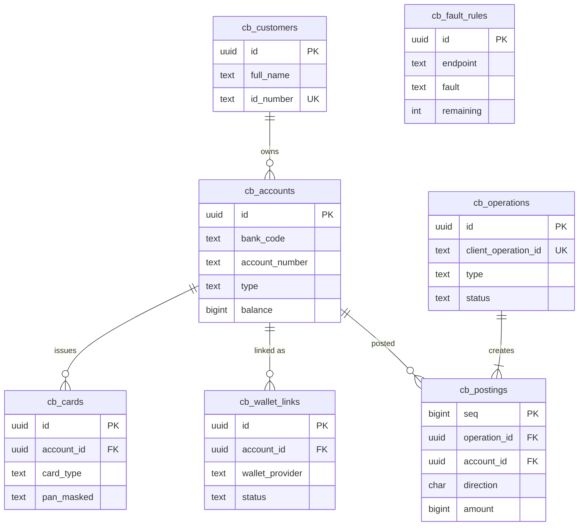

| Bảng | Cột chính | Ghi chú |
|---|---|---|
| `customers` | id, full_name, id_number (UK), date_of_birth | Dữ liệu seed; không mã hóa (đây là hệ thống giả lập) |
| `accounts` | id, customer_id NULL, bank_code, account_number, type (`CURRENT`/`SAFEGUARD`), owner_name, currency, balance (`CHECK ≥ 0`), status, version | UK `(bank_code, account_number)`. TK đảm bảo: `type = 'SAFEGUARD'`, `customer_id NULL`, chỉ dùng cho ví (BR-55) |
| `cards` | id, account_id, card_type (`DEBIT`/`CREDIT`), pan_hash, pan_masked, status | Liên kết bằng thẻ `CREDIT` bị từ chối (BR-11) |
| `wallet_links` | id, account_id, card_id NULL, wallet_provider, link_token_hash, otp_hash, status (`OTP_SENT`/`ACTIVE`/`REVOKED`) | |
| `operations` | id, **client_operation_id** (UK = `bank_operation_id`), client_id, type (`DEBIT_TO_SAFEGUARD`/`CREDIT_FROM_SAFEGUARD`/`INTERBANK_TRANSFER`), from_account_id, to_account_id, amount, request_hash, status (`SUCCEEDED`/`REJECTED`/`PROCESSING`), reason_code, sender_info JSONB, created_at, completed_at | Idempotent: cùng `client_operation_id` thì trả kết quả cũ; khác `request_hash` thì `409` |
| `postings` | seq, operation_id, account_id, direction, amount, balance_after, business_date, created_at | Double-entry nội bộ; dùng cho `/statements` |
| `fault_rules` | id, endpoint, match (JSONB, ví dụ `{"amount": 777000}`), fault (`delay`/`timeout`/`commit-then-drop`/`reject`/`processing`/`5xx`), param, remaining (NULL = vô hạn), enabled | Chỉ có hiệu lực ở profile `dev`/`test` (architecture §7.1) |

---

## 6. Máy trạng thái

Mọi chuyển trạng thái đều là **conditional update** (`UPDATE … SET status = $to, version = version + 1 WHERE id = $id AND status = $from AND version = $v`) và ghi vào bảng `*_history` tương ứng nếu có.

**`payment.payments.status`** (BR-45, 46)

| Từ | Sang | Khi nào |
|---|---|---|
| — | `SUCCEEDED` | TRANSFER, QR_PAYMENT, REFUND: hoàn tất đồng bộ trong 1 transaction |
| — | `PENDING` | TOPUP, WITHDRAW, INTERBANK: tạo lệnh (+ hold với WITHDRAW/INTERBANK) |
| `PENDING` | `SUCCEEDED` | corebank xác nhận |
| `PENDING` | `FAILED` | corebank từ chối chắc chắn (release hold, hoàn hạn mức) |
| `PENDING` | `NEEDS_RECONCILIATION` | Quá 24h chưa rõ |
| `NEEDS_RECONCILIATION` | `SUCCEEDED` / `FAILED` | Đối soát hoặc vận hành kết luận |
| `SUCCEEDED` | `REVERSED` | Bút toán đảo được duyệt (maker–checker) |

`CREATED` chỉ dùng nội bộ, trước khi commit lần đầu.

**`banklink.operations.status`**: `PENDING → SENT → SUCCEEDED | REJECTED | UNKNOWN`; `UNKNOWN → SUCCEEDED | REJECTED` (tra cứu); `UNKNOWN → NEEDS_RECONCILIATION` (quá 24h).

**`merchant.orders.status`**: `CREATED → PAID | EXPIRED | CANCELLED`; `PAID → PARTIALLY_REFUNDED → REFUNDED`; `PAID → REFUNDED` (hoàn toàn bộ).

**`kyc.sessions.status`**: `CREATED → DOCUMENTS_UPLOADED → PROCESSING → APPROVED | REJECTED | MANUAL_REVIEW`; `PROCESSING → RETRYABLE_ERROR → PROCESSING`; `MANUAL_REVIEW → APPROVED | REJECTED`; `CREATED | DOCUMENTS_UPLOADED → EXPIRED`.

**`wallet.wallets.status`** (BR-05, 07, 61, 62, 63)

| Từ | Sang | Điều kiện |
|---|---|---|
| `INACTIVE` | `ACTIVE` | `onboarding_status = KYC_VERIFIED` **và** ≥ 1 link `VERIFIED` |
| `ACTIVE` | `SUSPENDED` | CCCD hết hạn, nghi gian lận, chênh lệch đối soát |
| `SUSPENDED` | `ACTIVE` | eKYC lại thành công / vận hành gỡ (có audit) |
| `ACTIVE` / `SUSPENDED` | `FROZEN` | Khách hàng hoặc cơ quan có thẩm quyền yêu cầu |
| `FROZEN` | `ACTIVE` | Gỡ phong tỏa (STAFF, có lý do) |
| `ACTIVE` / `SUSPENDED` | `CLOSED` | Số dư = 0, không có hold `ACTIVE`, không có payment `PENDING` |

---

## 7. Index cho truy vấn nóng & job kiểm tra

| Truy vấn | Index |
|---|---|
| Claim outbox | `platform.outbox_events (available_at) WHERE status IN ('PENDING','PROCESSING')` |
| Bank runner | `banklink.operations (status, next_attempt_at) WHERE status IN ('PENDING','SENT','UNKNOWN')` |
| Lịch sử ví (keyset) | `payment.wallet_activities (wallet_id, occurred_at DESC, id DESC)` |
| Sao kê ledger | `ledger.entries (account_id, seq DESC)` |
| Payment pending lâu | `payment.payments (status, pending_since) WHERE status IN ('PENDING','NEEDS_RECONCILIATION')` |
| Hạn mức | PK `limits.usage (customer_id, bucket, period_key)` |
| QR lookup | UK `merchant.orders (qr_token_hash)` |
| QR hết hạn | `merchant.orders (status, expires_at) WHERE status = 'CREATED'` |
| CCCD sắp hết hạn | `kyc.verified_identities (expiry_date)` |
| Ví không hoạt động | `wallet.wallets (status, last_activity_at)` |

Các job kiểm tra toàn vẹn chạy hằng ngày (architecture §10):

```sql
-- Drift: balance tổng hợp khác số dư tính từ entries
SELECT a.id, a.balance,
       SUM(CASE WHEN e.direction = a.normal_side THEN e.amount ELSE -e.amount END) AS computed
  FROM ledger.accounts a
  LEFT JOIN ledger.entries e ON e.account_id = a.id
 GROUP BY a.id
HAVING a.balance <> COALESCE(SUM(CASE WHEN e.direction = a.normal_side THEN e.amount ELSE -e.amount END), 0);

-- Phương trình kế toán: ASSET = LIABILITY + REVENUE
SELECT SUM(balance) FILTER (WHERE type = 'ASSET')
     - SUM(balance) FILTER (WHERE type IN ('LIABILITY','REVENUE')) AS gap
  FROM ledger.accounts;   -- phải = 0

-- Hold: tổng các hold ACTIVE = số dư WALLET_HOLD
SELECT (SELECT COALESCE(SUM(amount), 0) FROM ledger.holds WHERE status = 'ACTIVE')
     - (SELECT balance FROM ledger.accounts WHERE code = 'WALLET_HOLD') AS gap;  -- phải = 0
```

---

## 8. Retention

Theo BR-73. Job `platform.cleanup` và `kyc.purge` thực hiện.

| Dữ liệu | Thời hạn | Cách xử lý |
|---|---|---|
| `ledger.*`, `payment.*`, `banklink.operations*`, `merchant.orders/refunds` | 10 năm (`retention.ledger_years`) | Giữ nguyên; archive sau (ngoài MVP) |
| `kyc.verified_identities`, `kyc.documents` + object MinIO, `kyc.checks` | 5 năm sau khi đóng ví | Xóa object và crypto-shred (xóa DEK), giữ `id_number_hash` để chống mở trùng |
| `identity.consents`, `audit.audit_logs` | 5 năm sau khi đóng ví (audit tối thiểu 5 năm) | |
| `kyc.sessions` không hoàn tất | 30 ngày | Xóa kèm ảnh |
| `identity.phone_verifications`, `authz.challenges` | 30 ngày | Xóa |
| `platform.idempotency_keys` | 7 ngày | Xóa |
| `platform.outbox_events` `DONE`, `processed_events` | 30 ngày | Xóa |
| `identity.refresh_tokens` hết hạn/thu hồi | 30 ngày | Xóa |

---

## 9. Truy vết bảng → BR

| BR | Bảng / ràng buộc |
|---|---|
| BR-01, 02 | `identity.customers.date_of_birth`, `wallet.wallets` UK `customer_id` |
| BR-03 | `identity.phone_verifications`, `customers.phone` UK |
| BR-04, 06, 08 | `kyc.sessions`, `kyc.documents`, `kyc.checks`, `kyc.verified_identities` |
| BR-05 | Chuyển trạng thái ví §6 |
| BR-07 | `kyc.verified_identities.expiry_date`, `expiry_notified_at` |
| BR-10…14 | `banklink.links` (`source_type` không có CREDIT_CARD, partial UK), corebank `cards`, `wallet_links` |
| BR-20…24 | `payment.payments`, ma trận §3.2, `ledger.accounts` CHECK số dư |
| BR-25…29, 37 | `limits.usage`, `limits.consumptions`, `merchant.merchants.category`, `platform.settings` |
| BR-30 | `payment.payments.fee`, account `FEE_REVENUE` |
| BR-35…40 | `identity.credentials`, `identity.devices`, `authz.challenges`, `payment.payments.auth_level` |
| BR-45…50 | `payment.payments`, `payment.status_history`, `banklink.operations`, `ledger.holds` |
| BR-51, 52 | `merchant.orders` (UK, `qr_token_hash`, `expires_at`), `merchant.callback_deliveries`, UK QR_PAYMENT theo `order_id` |
| BR-53 | `merchant.merchants.status` |
| BR-55…58 | `SAFEGUARD_BANK`, `RECON_SUSPENSE`, `recon.runs/items/adjustments`, corebank `accounts.type = SAFEGUARD` |
| BR-60 | `dispute.disputes` |
| BR-61, 74 | `risk.aml_alerts` |
| BR-62, 63 | `wallet.wallets` (`last_activity_at`, `dormant_notified_at`, `closed_at`) |
| BR-64 | `recon.adjustments` (CHECK maker ≠ checker), `audit.audit_logs` |
| BR-70 | `identity.consents` |
| BR-71 | Các cột `_enc` / `_hash`, quyền trên `audit` |
| BR-73 | §8 |

## 10. Lịch sử cập nhật

- 2026-10-18: Review `erd.md` done