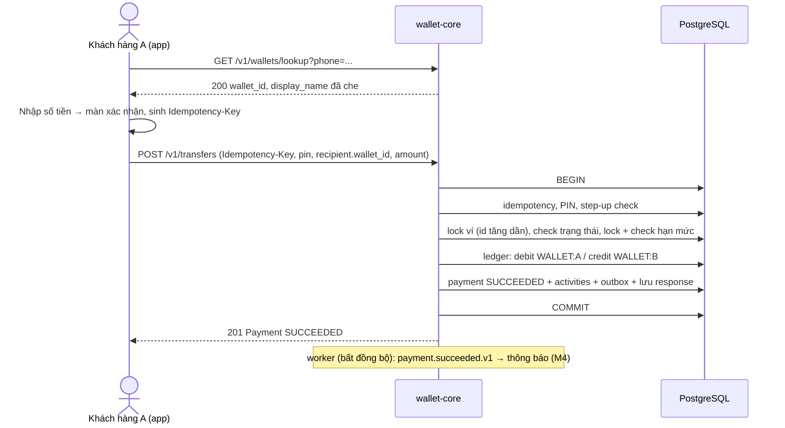

# FSD 04 — Chuyển tiền ví–ví

> Trạng thái: **DRAFT** · Cập nhật: 2026-10-25 · Milestone: **M0**
> Liên quan: [fsd/README](README.md) (CF-xx, thông báo) · [urd.md](../urd.md) US-21, US-24 · [prd.md](../prd.md) F-05, F-07 · [business-rules.md](../business-rules.md) BR-23…29, 35, 36, 39, 47 · [architecture.md](../architecture.md) §5.2 · [erd.md](../erd.md) §3.2, §4.5, §4.7

| UC | Tên | Milestone |
|---|---|---|
| [UC-04.01](#uc-0401--chuyển-tiền-víví-bằng-sđt) | Chuyển tiền ví–ví bằng SĐT | M0 |
| [UC-04.02](#uc-0402--xác-thực-giao-dịch-bằng-pin) | Xác thực giao dịch bằng PIN | M0 |

---

## UC-04.01 — Chuyển tiền ví–ví bằng SĐT

| Thuộc tính | Giá trị |
|---|---|
| Actor | Khách hàng gửi (P1, P2). Khách hàng nhận là actor thụ động. |
| Mục tiêu | Chuyển tiền tức thời từ ví mình sang ví của người khác trong hệ thống. |
| Trigger | Người dùng chọn **Chuyển tiền** trên màn hình chính. |
| Tiền điều kiện | Đã đăng nhập trên thiết bị đang hoạt động; ví gửi `ACTIVE`; đã có PIN. Ở M0 khách hàng, ví, PIN và thiết bị được tạo bằng seed `dev`, và khách hàng được xác định bằng xác thực dev (fsd/README §8.1, §8.2). |
| Hậu điều kiện — thành công | 1 payment `TRANSFER` ở trạng thái `SUCCEEDED`; ví gửi giảm, ví nhận tăng đúng `amount` (bút toán erd §3.2 dòng 2); hạn mức `MONTH_GENERAL` và `DAY_OTHER` của người gửi tăng `amount`; 2 dòng lịch sử (OUT cho người gửi, IN cho người nhận); event `payment.succeeded.v1`. |
| Hậu điều kiện — thất bại | Không có payment, không có bút toán, hạn mức không đổi. Lỗi nghiệp vụ `422` được lưu với `Idempotency-Key` (CF-04). |
| Milestone · US · F | M0 · US-21, US-24 · F-05, F-07 |

### Luồng chính

| # | Actor | Hệ thống |
|---|---|---|
| 1 | Chọn **Chuyển tiền**. | Hiện S-04.1. |
| 2 | Nhập SĐT người nhận, bấm **Tiếp tục**. | Chuẩn hóa SĐT về `+84…` và gọi `lookupRecipient`. |
| 3 | | Trả `wallet_id`, tên đã che (CF-02). Hiện S-04.2 với tên người nhận. |
| 4 | Nhập số tiền, nội dung (tùy chọn), bấm **Tiếp tục**. | Kiểm tra phía client: số tiền trong khoảng, ≤ số dư khả dụng đã biết (chỉ cảnh báo, backend mới quyết định). |
| 5 | | Hiện S-04.3: người nhận, số tiền, phí `0 đ` (BR-30), số dư sau giao dịch, nội dung. Sinh `Idempotency-Key` (CF-04). |
| 6 | Bấm **Xác nhận**, nhập PIN 6 số. | Gọi `createTransfer` với `recipient.wallet_id` lấy ở bước 3. |
| 7 | | Xử lý theo [§Xử lý phía hệ thống](#xử-lý-phía-hệ-thống). Trả `201`, `status = SUCCEEDED`. |
| 8 | | Hiện S-04.4: **Chuyển tiền thành công**, số tiền, người nhận, thời gian, mã giao dịch. Nút **Về trang chủ**, **Chuyển tiếp**. |

### Luồng thay thế

| ID | Rẽ tại | Mô tả |
|---|---|---|
| A1 | 2 | Chọn từ **Người nhận gần đây** (5 người nhận gần nhất lấy từ lịch sử `TRANSFER` OUT) hoặc danh bạ máy. Vẫn gọi `lookupRecipient` để lấy tên mới nhất, rồi sang bước 3. |
| A2 | 7 | Vượt ngưỡng xác thực mạnh (BR-36): server trả `401 STEP_UP_REQUIRED`. Client thực hiện CF-05, rồi gửi lại bước 6 với cùng key + `X-Challenge-Id`. **M0: dừng ở đây**, giao dịch không hoàn tất (CF-05 — giới hạn M0). |
| A3 | 7 | Mất mạng / timeout: client gửi lại với cùng key (CF-06). Nếu lần đầu đã thành công, server trả lại đúng response cũ, không chuyển lần 2. |
| A4 | 5 | Người dùng bấm **Quay lại** để sửa số tiền hoặc người nhận → về S-04.2 / S-04.1; khi tới S-04.3 lần nữa sinh key mới. |

### Luồng ngoại lệ

| ID | Điều kiện | Bước | Mã lỗi | Hành vi |
|---|---|---|---|---|
| E1 | SĐT sai định dạng | 2 | — (client) | "Số điện thoại không hợp lệ." |
| E2 | SĐT chưa có ví, hoặc ví nhận không `ACTIVE` | 3 | `404 NOT_FOUND` | "Số điện thoại này chưa đăng ký ví hoặc không thể nhận tiền." Không phân biệt hai trường hợp (tránh dò trạng thái ví người khác). |
| E3 | SĐT là của chính mình | 3 | `422 RECIPIENT_INVALID` (`reason = SELF`) | §5 README |
| E4 | Tra cứu quá `lookup.max_per_hour` = 30 lần/giờ [P] | 2 | `429 RATE_LIMITED` | §5 README. Chống dò danh sách SĐT. |
| E5 | Số tiền < `transfer.min_amount` (1.000) hoặc > `txn.max_amount_per_txn` (50.000.000) | 4, 7 | `422 AMOUNT_OUT_OF_RANGE` | §5 README |
| E6 | Ví gửi không `ACTIVE` | 7 | `403 WALLET_NOT_ACTIVE` / `403 ONBOARDING_INCOMPLETE` (nếu `INACTIVE`) | §5 README, CF-08 |
| E7 | Ví nhận đổi trạng thái giữa bước 3 và 7 | 7 | `422 RECIPIENT_INVALID` (`reason = NOT_ACTIVE`) | §5 README |
| E8 | PIN sai / bị khóa | 7 | `401 PIN_INVALID` / `423 PIN_LOCKED` | UC-04.02 |
| E9 | Số dư khả dụng < `amount` | 7 | `422 INSUFFICIENT_FUNDS` (`details.available`) | §5 README |
| E10 | Vượt hạn mức tháng | 7 | `422 LIMIT_EXCEEDED` (`limit_type = MONTH_GENERAL`, `details.remaining`) | §5 README |
| E11 | Vượt hạn mức thiết bị mới (BR-38) | 7 | `422 LIMIT_EXCEEDED` (`limit_type = NEW_DEVICE_DAILY`) | §5 README. Ở M0 chưa có đổi thiết bị nên không xảy ra. |
| E12 | Cùng key, nội dung khác | 7 | `422 IDEMPOTENCY_KEY_REUSED` | CF-04 |
| E13 | Cùng key đang xử lý | 7 | `409 IDEMPOTENCY_IN_PROGRESS` | CF-04 |

Mọi ngoại lệ ở bước 7 xảy ra **trước** khi ghi bút toán, hoặc làm rollback toàn bộ transaction. Chuyển ví–ví không có trạng thái `PENDING`.

### Màn hình & trường

**S-04.1 — Người nhận**

| Trường | Kiểu | Bắt buộc | Kiểm tra | Nguồn |
|---|---|---|---|---|
| Số điện thoại | text (bàn phím số) | ✔ | Chấp nhận `0xxxxxxxxx` hoặc `+84xxxxxxxxx`; chuẩn hóa về `^\+84[0-9]{9,10}$` (schema `Phone`) | Người dùng / danh bạ |
| Người nhận gần đây | danh sách | | Tối đa 5 | `listWalletActivities?type=TRANSFER&direction=OUT` (client lọc trùng) |

**S-04.2 — Số tiền**

| Trường | Kiểu | Bắt buộc | Kiểm tra | Nguồn |
|---|---|---|---|---|
| Người nhận | hiển thị | | Tên đã che + SĐT đã che | `lookupRecipient` |
| Số tiền | số nguyên (CF-01) | ✔ | 1.000 ≤ x ≤ 50.000.000; cảnh báo nếu > số dư khả dụng | Người dùng |
| Gợi ý nhanh | nút | | 50.000 · 100.000 · 200.000 · 500.000 | Cố định |
| Số dư khả dụng | hiển thị | | | `getWallet` |
| Nội dung | text | | ≤ 140 ký tự; bỏ ký tự điều khiển; mặc định `<HỌ TÊN NGƯỜI GỬI> chuyen tien` nếu để trống [P] | Người dùng |

**S-04.3 — Xác nhận**: người nhận, số tiền, phí `0 đ`, tổng trừ, số dư sau giao dịch, nội dung. Dòng nhắc: "Giao dịch chuyển tiền ví–ví không thể hủy sau khi xác nhận." (BR-47). Nút **Xác nhận** mở bàn phím PIN (UC-04.02).

**S-04.4 — Kết quả**: dùng chung bố cục với màn chi tiết giao dịch (UC-07.04).

### Xử lý phía hệ thống

`createTransfer` chạy trong **một DB transaction** (architecture §5.2). Thứ tự kiểm tra cố định để lỗi trả về nhất quán:

| # | Bước | BR | Lỗi |
|---|---|---|---|
| 1 | Xác thực token, `X-Device-Id` là thiết bị active. **M0**: chỉ xác định khách hàng bằng xác thực dev, chưa kiểm thiết bị (fsd/README §8.2) | BR-38 | `401 UNAUTHENTICATED` / `DEVICE_NOT_BOUND` (từ M3) |
| 2 | Kiểm tra định dạng request | — | `400 VALIDATION_ERROR` |
| 3 | Idempotency: key đã có kết quả → trả lại; đang xử lý → `409`; khác nội dung → `422` | NFR-02 | CF-04 |
| 4 | Kiểm tra PIN (UC-04.02) | BR-35, 39 | `401` / `423` |
| 5 | Khoảng số tiền | BR-28 | `AMOUNT_OUT_OF_RANGE` |
| 6 | Step-up: `amount > auth.strong_single_threshold` **hoặc** `DAY_OTHER.used + amount > auth.strong_daily_threshold` mà không có challenge `VERIFIED` khớp intent | BR-36, 37, 40 | `401 STEP_UP_REQUIRED` |
| 7 | Khóa **2 ví theo `wallet_id` tăng dần** (`SELECT … FOR UPDATE`) — tránh deadlock khi A→B và B→A cùng lúc | — | |
| 8 | Ví gửi `ACTIVE`; ví nhận `ACTIVE` và khác ví gửi | BR-05, 23 | `WALLET_NOT_ACTIVE` / `RECIPIENT_INVALID` |
| 9 | Khóa và kiểm tra hạn mức: `MONTH_GENERAL` (BR-25), hạn mức thiết bị mới (BR-38); ghi `limits.consumptions` cho `MONTH_GENERAL` và `DAY_OTHER` | BR-25, 29, 37 | `LIMIT_EXCEEDED` |
| 10 | Ghi bút toán debit `WALLET:A` / credit `WALLET:B`. Số dư âm bị chặn bởi `CHECK` ở DB → map thành `INSUFFICIENT_FUNDS` | BR-24 | `INSUFFICIENT_FUNDS` |
| 11 | Insert `payment.payments` (`SUCCEEDED`, `auth_level`, `limit_category = GENERAL`), 2 dòng `payment.wallet_activities`, outbox `payment.succeeded.v1`, lưu response vào `platform.idempotency_keys`; nếu có challenge thì `VERIFIED → CONSUMED` | BR-40, 45, 47 | |
| 12 | COMMIT, trả `201` | | |

Ghi chú:

- Bước 6 dùng `DAY_OTHER` của **hôm nay** (BR-27) và chỉ đọc; bước 9 mới cộng.
- Kiểm tra số dư ở bước 10 là kiểm tra cuối cùng; có thể kiểm tra sớm hơn để trả lỗi nhanh nhưng không thay thế ràng buộc DB.
- Người nhận **không** bị tính hạn mức (BR-25: nhận tiền không tính).

### Dữ liệu

| Hạng mục | Chi tiết |
|---|---|
| API | `lookupRecipient`, `createTransfer` |
| Bảng | `payment.payments`, `payment.wallet_activities`, `ledger.transactions`, `ledger.entries`, `ledger.accounts` (số dư), `limits.usage`, `limits.consumptions`, `platform.idempotency_keys`, `platform.outbox_events`, `authz.challenges` (khi có step-up) |
| Trạng thái | payment: `— → SUCCEEDED` (erd §6) |
| Bút toán | erd §3.2 dòng 2: debit `WALLET:A`, credit `WALLET:B`, số tiền `amount` |
| Event | `payment.succeeded.v1` (payload: `payment_id`, `type`, `amount`, `source_wallet_id`, `dest_wallet_id`). Consumer ở M0: không có; M4: notification cho cả hai bên (UC-07.07), AML rule (c) BR-74. |
| Audit | Không ghi audit cho từng giao dịch (đã có ledger + payment + status history). Chỉ ghi `auth.pin.locked` khi khóa PIN (UC-04.02). |

### Sequence

Chi tiết theo module (authz, payment, limit, ledger): architecture §5.2.

### Tiêu chí chấp nhận

Từ urd.md **US-21**: tên người nhận đã che trước khi xác nhận; không đủ số dư / vượt hạn mức bị từ chối kèm số còn lại; thành công thì hai bên thấy ngay, không hủy được; không chuyển cho chính mình. Từ **US-24**: phần ngưỡng — xem A2.

Bổ sung ở mức hệ thống:

| # | Given | When | Then |
|---|---|---|---|
| AC-1 | A có 500.000 đ | A chuyển 200.000 đ cho B | A khả dụng 300.000 đ; B tăng 200.000 đ; `MONTH_GENERAL` của A tăng 200.000 đ; B không đổi hạn mức |
| AC-2 | Request thành công | Gửi lại cùng `Idempotency-Key` | Nhận đúng response cũ (cùng `payment_id`); chỉ 1 bút toán |
| AC-3 | A có 100.000 đ | 2 lệnh 80.000 đ khác key gửi đồng thời | Đúng 1 lệnh thành công, lệnh kia `INSUFFICIENT_FUNDS`; số dư không âm |
| AC-4 | A và B cùng có tiền | A→B và B→A gửi đồng thời nhiều lần | Không có deadlock không xử lý; tổng số dư A + B không đổi |
| AC-5 | `MONTH_GENERAL` của A đã dùng 99.900.000 đ | A chuyển 200.000 đ | `LIMIT_EXCEEDED`, `remaining = 100.000`; không có payment |
| AC-6 | A chuyển 12.000.000 đ, chưa có challenge | Gửi lệnh | `401 STEP_UP_REQUIRED`; không có payment, hạn mức không đổi |
| AC-7 | Lệnh bị lỗi `INSUFFICIENT_FUNDS` | A nạp thêm rồi gửi lại **cùng key** | Vẫn nhận `INSUFFICIENT_FUNDS` (kết quả đã lưu); app phải sinh key mới (CF-04) |
| AC-8 | **SM-01** | 1.000 lệnh chéo đồng thời giữa nhiều ví | 0 lệch ledger (Σdebit = Σcredit, số dư = Σentries), 0 số dư âm |

---

## UC-04.02 — Xác thực giao dịch bằng PIN

UC dùng chung (include) cho mọi lệnh thay đổi tiền: chuyển ví–ví (M0), nạp, rút, liên ngân hàng (M1), thanh toán QR (M2), đóng ví (M4). Đặt, đổi, đặt lại PIN thuộc fsd/01 (M3); ở M0 PIN được tạo bằng seed.

| Thuộc tính | Giá trị |
|---|---|
| Actor | Khách hàng |
| Mục tiêu | Xác nhận đúng chủ ví đang thực hiện giao dịch. |
| Trigger | Bấm **Xác nhận** ở màn xác nhận của một giao dịch. |
| Tiền điều kiện | Đã có PIN; PIN không bị khóa. |
| Hậu điều kiện — thành công | Bộ đếm sai PIN về 0; lệnh được xử lý tiếp. |
| Hậu điều kiện — thất bại | Bộ đếm tăng; có thể bị khóa tạm hoặc khóa cứng. Không có payment, không chiếm `Idempotency-Key`. |
| Milestone · US · F | M0 · US-24 (phần PIN), US-05 · F-07 |

### Luồng chính

| # | Actor | Hệ thống |
|---|---|---|
| 1 | Nhập 6 chữ số trên bàn phím PIN (S-04.5). | Tự gửi khi đủ 6 số; PIN nằm trong body lệnh giao dịch. |
| 2 | | Nếu PIN đang khóa → E2/E3. So khớp argon2id với `identity.credentials.pin_hash`. |
| 3 | | Đúng: đặt `pin_failed_count = 0`, tiếp tục lệnh giao dịch. |

### Luồng ngoại lệ

| ID | Điều kiện | Mã lỗi | Hành vi |
|---|---|---|---|
| E1 | PIN sai, chưa tới ngưỡng | `401 PIN_INVALID` (`remaining_attempts`) | Tăng `pin_failed_count`. Xóa ô PIN, rung nhẹ, hiện số lần còn lại. Người dùng nhập lại; client gửi lại **cùng key**. |
| E2 | Lần sai thứ `auth.pin_max_failures` (5) | `423 PIN_LOCKED` (`locked_until`) | Đặt `pin_locked_until = now + auth.pin_lock_minutes` (30 phút). Ghi audit `auth.pin.locked`. |
| E3 | Đang trong thời gian khóa | `423 PIN_LOCKED` (`locked_until`) | Không kiểm tra PIN, không tăng bộ đếm. |
| E4 | Sai thêm 1 lần **sau khi hết khóa tạm** (bộ đếm chưa về 0) | `423 PIN_LOCKED` (`hard_locked = true`) | Đặt `pin_hard_locked = true`. Chỉ mở được bằng đặt lại PIN qua OTP + khuôn mặt (BR-39, fsd/01). Ghi audit `auth.pin.locked` (`metadata.hard = true`). |

Ghi chú:

- Bộ đếm là **theo khách hàng**, dùng chung cho mọi loại giao dịch và mọi thiết bị.
- Hết khóa tạm, bộ đếm **không** về 0: còn đúng 1 lần thử; sai tiếp → khóa cứng (E4), đúng → về 0.
- Cập nhật bộ đếm chạy trong transaction **riêng** và commit ngay cả khi lệnh giao dịch bị lỗi (không bị rollback cùng lệnh).
- PIN không bao giờ được log, không nằm trong audit, không tính vào hash idempotency (BR-71, CF-04).
- Kiểm tra PIN trước step-up: người dùng không phải làm OTP + khuôn mặt nếu PIN đã sai.

### Màn hình

**S-04.5 — Bàn phím PIN** (bottom sheet): tiêu đề "Nhập mã PIN để xác nhận", 6 ô che, bàn phím số do app tự vẽ (không dùng bàn phím hệ thống), link **Quên PIN?** (fsd/01). Chặn chụp màn hình khi đang hiện.

### Dữ liệu

| Hạng mục | Chi tiết |
|---|---|
| API | Trường `pin` trong body của `createTransfer` (và các lệnh giao dịch khác) |
| Bảng | `identity.credentials`: `pin_hash`, `pin_failed_count`, `pin_locked_until`, `pin_hard_locked` |
| Audit | `auth.pin.locked` (actor `CUSTOMER`, resource `customer`, outcome `DENIED`) |

### Tiêu chí chấp nhận

Từ urd.md **US-05**: sai PIN 5 lần liên tiếp bị khóa 30 phút, app hiện thời điểm mở khóa.

| # | Given | When | Then |
|---|---|---|---|
| AC-1 | Bộ đếm = 0 | Nhập sai 4 lần | Mỗi lần `PIN_INVALID`, `remaining_attempts` lần lượt 4, 3, 2, 1 |
| AC-2 | Bộ đếm = 4 | Nhập sai lần 5 | `PIN_LOCKED`, `locked_until ≈ now + 30 phút`; 1 dòng audit |
| AC-3 | Đang khóa | Nhập **đúng** PIN | Vẫn `PIN_LOCKED`; không giao dịch |
| AC-4 | Hết khóa tạm | Nhập sai | `PIN_LOCKED` với `hard_locked = true` |
| AC-5 | Bộ đếm = 3 | Nhập đúng | Giao dịch tiếp tục; bộ đếm = 0 |
| AC-6 | PIN sai ở lần gửi đầu | Gửi lại cùng `Idempotency-Key` với PIN đúng | Giao dịch được xử lý bình thường (key không bị chiếm) |
| AC-7 | Bất kỳ | Kiểm tra log ứng dụng và audit | Không có giá trị PIN |
