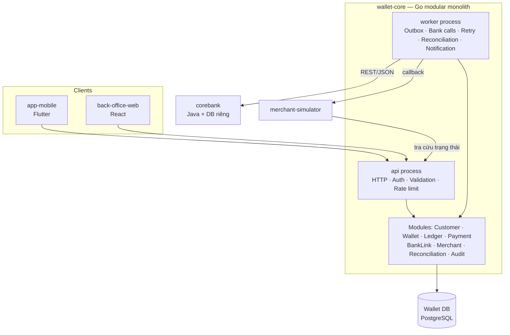
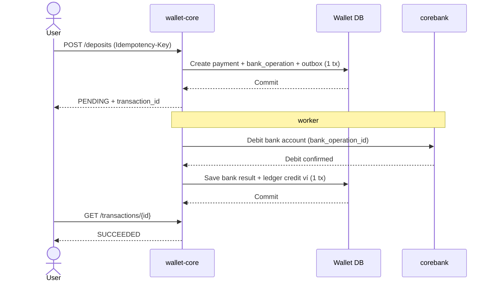
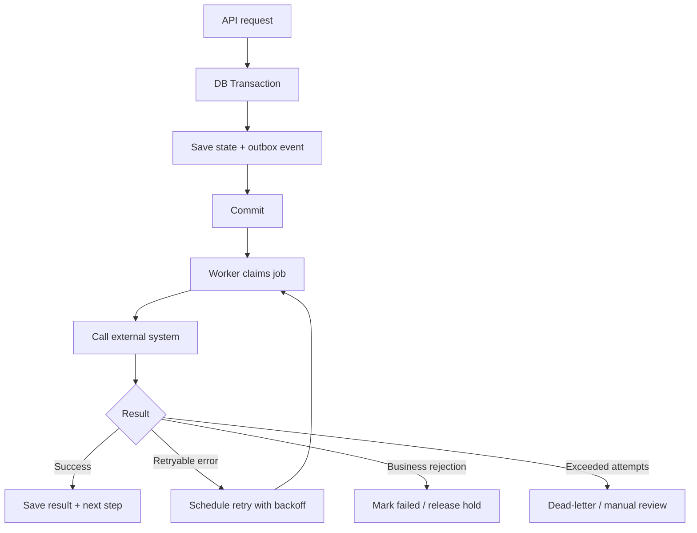

# E-Wallet Platform — Planning

> Nguồn thảo luận: https://chatgpt.com/share/6ad0fca4-bad0-83ec-a5b8-d8c4a680fca3
> Cảm hứng: ví MoMo (Việt Nam). Đây là project học tập / portfolio, **không xử lý tiền thật**, mọi ngân hàng và đơn vị thanh toán bên ngoài đều là **giả lập**.

---

## 1. Mục tiêu & phạm vi MVP

Người dùng có thể:

1. Đăng ký, đăng nhập, hoàn thành định danh (eKYC) mô phỏng.
2. Liên kết tài khoản ngân hàng với ví.
3. Nạp tiền từ tài khoản ngân hàng vào ví.
4. Chuyển tiền ví → ví (nội bộ).
5. Chuyển/rút tiền từ ví → tài khoản ngân hàng (kể cả ngân hàng khác, qua mạng thanh toán giả lập).
6. Quét QR để thanh toán dịch vụ cho merchant.
7. Xem số dư, lịch sử và trạng thái giao dịch.

Lưu ý: "chuyển liên ngân hàng" và "thanh toán QR" không chỉ là thêm API — chúng kéo theo mô hình giao dịch, đối soát, xử lý timeout và tích hợp hệ thống ngoài. Mục tiêu là **mô phỏng đúng các vấn đề kiến trúc**.

---

## 2. Các hệ thống tham gia

| Hệ thống | Công nghệ | End-user | Trách nhiệm |
|---|---|---|---|
| `wallet-core` | Go — modular monolith | — | Trung tâm nghiệp vụ: khách hàng, ví, sổ cái, lệnh thanh toán, liên kết ngân hàng, merchant, đối soát, audit. Nơi quyết định giao dịch có được thực hiện hay không. |
| `app-mobile` | Flutter | Người dùng phổ thông | Đăng ký/đăng nhập, liên kết NH, nạp/rút, chuyển tiền, quét QR, lịch sử. **Chỉ gửi yêu cầu & hiển thị**, không tự quyết định số dư/trạng thái. |
| `back-office-web` | ReactJS (dự trù, có thể hoãn sau MVP) | Nhân viên vận hành / quầy | Tra cứu khách hàng, giao dịch, giao dịch pending, lỗi tích hợp, merchant, đối soát; thao tác hỗ trợ có phân quyền + audit. |
| `corebank` | Java — DB riêng | — | Ngân hàng giả lập: tài khoản, số dư, phong tỏa / ghi nợ / ghi có, giao dịch NH. Mô phỏng timeout, từ chối, phản hồi chậm. Quản lý **tài khoản đảm bảo thanh toán** của công ty ví (scope BR-55). |
| `merchant-simulator` | (chưa cần app riêng, có thể là module/tool nhỏ) | — | Đơn vị cung cấp dịch vụ / chấp nhận QR: tạo đơn hàng, QR, nhận callback, tra cứu trạng thái. |

### Ranh giới hệ thống

- `wallet-core` và `corebank` có **database riêng**, không đọc/ghi DB của nhau — chỉ giao tiếp qua API.
- Client (mobile, back-office) chỉ truy cập backend qua API; **không tin số dư/trạng thái do client gửi lên**.



`api` và `worker` là **hai process build từ cùng một codebase** → vẫn là modular monolith, không phải microservices.

---

## 3. Góc độ nghiệp vụ

### 3.1. Module nghiệp vụ trong `wallet-core`

| # | Module | Trách nhiệm chính | Ghi chú |
|---|---|---|---|
| A | **Identity & Customer** | Đăng ký, hồ sơ khách hàng, xác thực, session; trạng thái định danh (chưa xác minh / đã xác minh / cần kiểm tra lại); hạn mức theo trạng thái KH | eKYC là một capability của module này (xem §9) |
| B | **Wallet & Account** | Tạo ví; trạng thái ví `ACTIVE / FROZEN / CLOSED`; hiển thị số dư khả dụng; quản lý liên kết KH ↔ phương tiện thanh toán | **Không** tự cập nhật cột `balance` tùy ý |
| C | **Ledger & Accounting** | Bút toán double-entry; tổng debit = tổng credit cho mỗi giao dịch kế toán; lịch sử bất biến, sửa sai bằng **bút toán đảo** | Module quan trọng nhất về toàn vẹn tài chính |
| D | **Payment Orchestration** | Nạp, chuyển ví–ví, rút/chuyển ra NH, thanh toán QR; quản lý trạng thái, retry, timeout, kết quả cuối | Điều phối quy trình ≠ ghi sổ |
| E | **Bank Integration (BankLink)** | Liên kết & xác minh TK NH; gửi lệnh nạp/rút/chuyển; nhận callback hoặc truy vấn trạng thái; map mã lỗi NH → mô hình nội bộ | Không để logic riêng của corebank rò rỉ vào nghiệp vụ ví |
| F | **Merchant & QR** | Quản lý merchant, điểm chấp nhận; sinh/đọc QR; kiểm tra merchant, số tiền, nội dung; QR động/tĩnh, hết hạn | QR chỉ là phương tiện truyền dữ liệu, **không chứng minh** đã thanh toán |
| G | **History, Notification & Reconciliation** | Tra cứu giao dịch; thông báo khi đổi trạng thái; đối soát với corebank & merchant; phát hiện lệch / thiếu / trùng | Notification chạy async; đối soát **không phụ thuộc** notification |

Đây là 7 nhóm trách nhiệm trong **một** ứng dụng Go, dùng chung deploy nhưng tách rõ logic và quyền sở hữu dữ liệu.

### 3.2. Phân loại luồng tiền

| Nghiệp vụ | Nguồn | Đích | Hệ thống ngoài |
|---|---|---|---|
| Nạp tiền (top-up) | TK ngân hàng | Ví người dùng | corebank |
| Chuyển ví–ví | Ví A | Ví B | Không |
| Rút tiền (payout) | Ví người dùng | TK ngân hàng đã liên kết | corebank |
| Chuyển liên ngân hàng | Ví người dùng | TK tại ngân hàng khác | corebank + mạng thanh toán giả lập |
| Thanh toán QR | Ví người dùng | Merchant | merchant-simulator |
| Hoàn tiền (refund) | Giao dịch đã thanh toán | Ví người dùng | Có thể cần merchant/NH |

Phân biệt: ví → TK NH là **payout/withdrawal**; TK NH → TK NH khác là **bank transfer**. MVP bắt đầu với **ví → ngân hàng đích** qua hệ thống giả lập.

### 3.3. Quy tắc nghiệp vụ

Đã chốt trong [`scope.md`](scope.md), dựa trên quy định hiện hành (TT 40/2024 sửa bởi TT 41/2025, TT 50/2024 sửa bởi TT 77/2025, Luật PCRT 2022, Luật BVDLCN 2025). Bảng truy vết các câu hỏi cũ nằm ở `scope.md` §7. Mọi hạn mức/ngưỡng là cấu hình và được **cưỡng chế ở backend**.

---

## 4. Góc độ kỹ thuật

### 4.1. Các lớp bên trong Go

| Lớp | Nội dung |
|---|---|
| Transport | HTTP handlers, DTO, middleware |
| Application | Use cases, điều phối transaction, authorization rules |
| Domain | Entities, value objects, state transitions, invariants |
| Infrastructure | PostgreSQL, bank HTTP client, object storage, queue adapter |

Quy tắc phụ thuộc:

- `transport` → `application` → `domain` + interface.
- `infrastructure` triển khai interface cho DB và hệ thống ngoài.
- `domain` **không** phụ thuộc Gin, PostgreSQL, Redis hay corebank.
- Interface định nghĩa **phía sử dụng** (Go idiom): ví dụ `payment` định nghĩa `BankGateway` đúng những thao tác nó cần; adapter corebank triển khai.
- Module khác **không** gọi thẳng repository của module khác để sửa dữ liệu nội bộ — đi qua API (Go interface) của module đó.
- Ví dụ: use case `TransferBetweenWallets` không chứa SQL, không gọi HTTP handler.

### 4.2. Cấu trúc thư mục đề xuất

> Đã chốt chi tiết trong [`architecture.md`](architecture.md) §4 — bản dưới đây là tóm tắt.

```text
wallet-core/
├── cmd/
│   ├── api/main.go
│   └── worker/main.go
├── internal/
│   ├── identity/        # KH, auth, thiết bị, PIN, consent
│   ├── kyc/
│   ├── wallet/
│   ├── ledger/
│   ├── limit/           # hạn mức tháng/ngày
│   ├── authz/           # step-up (PIN / OTP + khuôn mặt)
│   ├── payment/
│   ├── banklink/
│   ├── merchant/
│   ├── reconciliation/
│   ├── risk/            # AML
│   ├── dispute/
│   ├── notification/
│   ├── audit/
│   ├── backoffice/
│   └── platform/        # db/tx, outbox, idempotency, auth, crypto, httpx, observability
├── migrations/
├── api/openapi.yaml
└── go.mod
```

Mỗi module có `service.go` (API public) và các package con riêng (`domain/`, `store/`, `http/`, `jobs/`) khi cần — quan trọng là ranh giới và hướng phụ thuộc.

### 4.3. Tech stack

| Thành phần | Lựa chọn ban đầu |
|---|---|
| HTTP | `net/http` + `chi` |
| Database | PostgreSQL 16 (wallet-core, schema/module), DB riêng cho corebank |
| DB access | `pgx` + `sqlc` |
| Migration | `golang-migrate` |
| Background job | PostgreSQL Outbox + worker; Redis/Asynq hoặc RabbitMQ chỉ khi cần |
| File storage (eKYC) | MinIO / S3-compatible |
| Logging | `log/slog` (structured) |
| Go ↔ Java | REST/JSON |
| API contract | OpenAPI |
| Testing | `testing`, `httptest`, testcontainers-go, `go test -race ./...` |
| Observability | OpenTelemetry → Jaeger, Prometheus, Grafana |
| corebank | Java 21 + Spring Boot 3 |
| Deployment | Docker Compose (monorepo) |

---

## 5. Thiết kế tài chính: Wallet, Ledger, Transaction

> Nếu ledger sai, các module khác hoạt động hoàn hảo thì số dư vẫn sai.

### 5.1. Ledger là nguồn sự thật

- **Không** coi cột `balance` là nguồn sự thật duy nhất. Dùng **double-entry ledger**; cột số dư tổng hợp (để query nhanh) chỉ được cập nhật **trong cùng DB transaction** với bút toán.
- Mỗi giao dịch kế toán: tổng debit = tổng credit. Chiều debit/credit theo loại tài khoản (không đồng nhất "debit = tiền giảm").
- Entries **bất biến**; sửa sai bằng bút toán đảo / điều chỉnh.

Ví dụ A chuyển 100.000đ cho B:

| Tài khoản ledger | Debit | Credit |
|---|---:|---:|
| Ví A | 100.000 | 0 |
| Ví B | 0 | 100.000 |
| **Tổng** | **100.000** | **100.000** |

Các tài khoản ledger hệ thống cần có (để nạp/rút/thanh toán cân bằng), ví dụ:

- `bank_settlement` — phản ánh **tài khoản đảm bảo thanh toán** của công ty ví tại corebank. Nạp tiền = TK KH → TK đảm bảo; rút/chuyển ra = TK đảm bảo → TK đích. Bất biến: số dư TK đảm bảo ≥ tổng số dư các ví (TT 40/2024 Đ27, scope BR-55/56).
- `wallet_hold` — tiền đang giữ chỗ cho payout chưa có kết quả.
- `merchant_payable` — số tiền phải trả merchant.
- `fee_revenue` — phí (nếu có).

Hạch toán chính xác phụ thuộc thời điểm ngân hàng xác nhận và quy trình đối soát — chốt trong `money-flows.md`.

### 5.2. Số dư khả dụng vs tổng số dư

Tiền đang giữ chỗ (payout pending) **không còn khả dụng**, dù chưa rời khỏi hệ thống → phân biệt `available_balance` và tổng số dư kế toán.

### 5.3. Ba khái niệm giao dịch tách biệt

| Khái niệm | Ý nghĩa |
|---|---|
| **Payment transaction** | Vòng đời nghiệp vụ: `PENDING`, `SUCCEEDED`, `FAILED`, … |
| **Ledger transaction** | Một lần ghi nhận kế toán gồm các bút toán cân bằng |
| **Bank operation** | Một lần tương tác với ngân hàng, có mã tham chiếu & kết quả riêng |

Một payment có thể có nhiều bank operation (timeout, truy vấn, retry) — nhưng retry **không được** tạo thêm lần ghi nợ.

### 5.4. Bảng dữ liệu cốt lõi

Đã chốt chi tiết trong [`erd.md`](erd.md): 16 schema (mỗi module một schema), cột, ràng buộc, trigger ép bất biến ledger, ma trận bút toán và máy trạng thái. Các điểm chính:

- Tài khoản ledger: `SAFEGUARD_BANK` (ASSET), `WALLET:<id>`, `WALLET_HOLD`, `MERCHANT_PAYABLE:<id>`, `FEE_REVENUE`, `RECON_SUSPENSE`.
- **Hold là bút toán thật** (`WALLET:<id>` → `WALLET_HOLD`) kèm bảng `ledger.holds`, nên số dư tài khoản ví chính là số dư khả dụng.
- `payment.payments` (vòng đời nghiệp vụ) ≠ `ledger.transactions` (ghi nhận kế toán) ≠ `banklink.operations` (tương tác ngân hàng).

Không cần tạo hết ngày đầu — tạo theo milestone.

---

## 6. Luồng nghiệp vụ end-to-end

Mỗi luồng mô tả theo 5 khía cạnh: **actor, preconditions, flow, trạng thái, failure handling** (chi tiết trong `money-flows.md` và `failure-scenarios.md`).

### 6.1. Liên kết ngân hàng

1. KH chọn ngân hàng, nhập thông tin tài khoản.
2. wallet-core gửi yêu cầu xác minh tới corebank.
3. corebank kiểm tra (OTP giả lập) và trả kết quả.
4. Thành công → tạo `bank_links`; Flutter hiển thị TK đã liên kết.

Trạng thái: `PENDING → VERIFIED | FAILED`. corebank timeout → **giữ `PENDING`** và truy vấn lại, không kết luận TK không hợp lệ. Không lưu mật khẩu Internet Banking.

### 6.2. Nạp tiền từ ngân hàng



Kịch bản khó: corebank ghi nợ thành công nhưng response bị mất.

- **Không** gửi lệnh ghi nợ mới với mã tham chiếu khác.
- Mỗi thao tác NH có `bank_operation_id` ổn định; **corebank phải hỗ trợ idempotency** theo mã đó + API tra cứu trạng thái.
- Wallet retry cùng mã hoặc truy vấn trạng thái; khi xác nhận thành công mới ghi ledger credit.
- Chưa xác định được → giữ trạng thái chờ xác minh, đưa vào đối soát.

### 6.3. Chuyển tiền ví–ví (làm đầu tiên)

Toàn bộ dữ liệu nằm trong một DB → phù hợp làm lát cắt đầu.

1. Xác thực người gửi, kiểm tra quyền.
2. Kiểm tra idempotency key.
3. Kiểm tra ví A/B, trạng thái ví, tiền tệ, hạn mức.
4. Trong **một DB transaction**: khóa (`SELECT ... FOR UPDATE`) hoặc conditional update để bảo vệ số dư.
5. Ghi bút toán debit/credit cân bằng; cập nhật số dư tổng hợp.
6. Ghi outbox event (notification).
7. Commit, trả kết quả `SUCCEEDED`.

Yêu cầu:

- Hai giao dịch đồng thời không được tiêu cùng một phần số dư.
- Số dư khả dụng không âm (trừ khi có cơ chế thấu chi định nghĩa rõ).
- Bất kỳ bước ghi sổ nào lỗi → rollback toàn bộ.
- Cùng idempotency key → không tạo 2 lần chuyển.
- **Khóa theo thứ tự nhất quán** (vd. theo `wallet_id` tăng dần) để tránh deadlock khi A→B và B→A đồng thời.

### 6.4. Rút / chuyển tiền ví → ngân hàng

1. Kiểm tra số dư, hạn mức.
2. Ghi yêu cầu payout + **giữ chỗ (hold)** số tiền trong ledger (cùng transaction) + outbox.
3. Worker gửi lệnh chuyển tới corebank.
4. Thành công → hoàn tất (chuyển hold sang settlement).
5. Thất bại **chắc chắn** → giải phóng hold.
6. Timeout không rõ kết quả → tiếp tục tra cứu & đối soát; **không tự động giải phóng** tiền.

### 6.5. Thanh toán QR

MVP bắt đầu với **QR động** (có số tiền + mã đơn hàng) — dễ kiểm soát hơn QR tĩnh.

Payload QR nội bộ minh họa (không phải chuẩn VietQR/liên ngân hàng):

```json
{
  "merchant_id": "merchant_001",
  "order_id": "order_20261013_001",
  "amount": 125000,
  "currency": "VND",
  "expires_at": "2026-10-13T16:00:00Z"
}
```

1. merchant-simulator tạo đơn hàng + QR.
2. Flutter quét QR, hiển thị tên merchant & số tiền (lấy từ backend, không tin nội dung QR).
3. Người dùng xác nhận.
4. wallet-core kiểm tra đơn hàng, hạn, số dư, quyền.
5. Ghi bút toán thanh toán (ví KH → merchant payable) trong DB transaction + outbox.
6. Worker gửi callback tới merchant; merchant cập nhật đơn.

Failure: wallet đã ghi nhận nhưng callback lỗi → retry callback, merchant có thể tra cứu theo `order_id`. Một đơn hàng **không được thanh toán trùng** (unique theo `merchant_id + order_id`). Môi trường thật cần chữ ký/chống giả mạo QR.

---

## 7. Xử lý bất đồng bộ & concurrency

### Outbox pattern

Vấn đề: ghi DB rồi gửi queue → DB commit OK nhưng gửi queue lỗi → giao dịch kẹt.
Giải pháp: ghi trạng thái **và** sự kiện vào `outbox_events` trong **cùng transaction**; worker đọc và xử lý. Outbox cho **at-least-once**, không phải exactly-once → consumer phải idempotent.



Nguyên tắc:

- **Idempotent worker**: chạy lại job không tạo kết quả/quyết định trùng.
- **Lease/claim job** (`FOR UPDATE SKIP LOCKED` + `available_at`): tránh 2 worker cùng xử lý.
- **Retry có backoff**, giới hạn số lần; **timeout** khi gọi provider.
- **Dead-letter** / trạng thái cần can thiệp khi lỗi quá số lần.
- **Optimistic locking / conditional update** (`WHERE status = <expected> AND version = ?`): kết quả cũ từ retry không được ghi đè quyết định mới.
- Phân biệt **business rejection** vs **technical failure** vs **cần kiểm tra thủ công** — không từ chối khách hàng chỉ vì dịch vụ tạm lỗi.

---

## 8. API contract

Ví dụ chuyển tiền nội bộ:

```http
POST /api/v1/transfers
Authorization: Bearer <token>
Idempotency-Key: <unique-key>
Content-Type: application/json

{
  "recipient_wallet_id": "wallet_B",
  "amount": 200000,
  "currency": "VND",
  "description": "Chuyen tien"
}
```

```json
{
  "transaction_id": "txn_01JXYZ",
  "status": "SUCCEEDED",
  "amount": 200000,
  "currency": "VND"
}
```

Nạp/rút tiền trả `PENDING` + `transaction_id` để client tra cứu.

Nguyên tắc:

- Số tiền là **số nguyên** theo đơn vị nhỏ nhất, luôn kèm `currency`. Không dùng `float64`.
- Phân biệt rõ `transaction_id` và `bank_operation_id`.
- Cùng idempotency key nhưng payload khác → **từ chối**.
- Có API tra cứu trạng thái giao dịch + lịch sử phân trang.
- `request_id` / `correlation_id` xuyên suốt các hệ thống.
- Chuẩn hóa mã lỗi nghiệp vụ: `INSUFFICIENT_FUNDS`, `WALLET_FROZEN`, `PAYMENT_PENDING`, … và map đúng HTTP status (không trả 500 cho lỗi nghiệp vụ).
- Client không bao giờ quyết định trạng thái thành công.
- ID public dùng UUID/ULID, không dùng ID tuần tự.
- Mô tả bằng OpenAPI (`api/openapi.yaml`), kể cả khi một người làm cả FE lẫn BE.

---

## 9. eKYC (capability của module Customer)

Quy trình: chụp CCCD → OCR trích xuất → selfie + liveness → face matching → risk check → kết quả.

- OCR / face / risk là **adapter giả lập** (mock provider); đổi sang provider thật chỉ cần thay adapter.
- State machine: `CREATED → DOCUMENT_PENDING → DOCUMENT_VERIFIED → BIOMETRIC_PENDING → RISK_REVIEW → APPROVED | REJECTED | MANUAL_REVIEW`.
- Provider timeout → giữ pending/retryable, **không** `REJECTED`.
- Ảnh CCCD lưu ở **private object storage** (MinIO), DB chỉ lưu `storage_key` + checksum; URL tải có thời hạn.
- Kiểm tra upload: giới hạn kích thước, kiểm tra định dạng thực tế (không tin MIME header).
- Không ghi CCCD, ảnh, token, dữ liệu sinh trắc vào log.
- Kết quả xác minh có lịch sử (provider, attempt, thời điểm, mã lỗi) — không chỉ một cột `is_verified`.
- API admin quyết định hồ sơ có phân quyền riêng + audit; client không tự gửi `status = APPROVED`.
- Trạng thái eKYC quyết định **hạn mức giao dịch** của ví.
- Không dùng ảnh CCCD thật của người khác khi demo.

API tham khảo:

| Method | Endpoint | Chức năng |
|---|---|---|
| POST | `/api/v1/ekyc/sessions` | Tạo phiên eKYC |
| POST | `/api/v1/ekyc/sessions/{id}/documents` | Upload CCCD |
| POST | `/api/v1/ekyc/sessions/{id}/selfie` | Upload selfie/video |
| POST | `/api/v1/ekyc/sessions/{id}/submit` | Gửi hồ sơ xử lý |
| GET | `/api/v1/ekyc/sessions/{id}` | Xem trạng thái |
| POST | `/api/v1/ekyc/sessions/{id}/retry` | Thử lại khi được phép |
| POST | `/api/v1/admin/ekyc/{id}/decision` | Nhân viên quyết định |

---

## 10. Bảo mật

| Rủi ro | Biện pháp |
|---|---|
| Upload file giả/độc hại | Giới hạn kích thước, kiểm tra định dạng thực tế |
| Truy cập ảnh CCCD trái phép | Private storage, phân quyền, pre-signed URL có hạn |
| Lộ dữ liệu cá nhân | Mã hóa khi truyền & lưu trữ, quản lý khóa riêng |
| Giả mạo request | AuthN/AuthZ, rate limiting, chống replay, idempotency |
| Nhân viên tự ý sửa/duyệt | RBAC, audit trail, không cho sửa balance trực tiếp |
| Rò rỉ qua log | Mask/loại bỏ CCCD, ảnh, token, dữ liệu sinh trắc |

Nếu hướng tới triển khai thực tế tại Việt Nam: rà soát quy định về dữ liệu cá nhân, định danh điện tử và trung gian thanh toán.

---

## 11. Back-office

Chưa cần React app lớn ngay; giai đoạn đầu dùng API test/công cụ đơn giản. Backend thiết kế sẵn để bổ sung sau.

MVP back-office:

- Tra cứu khách hàng, trạng thái ví.
- Tìm giao dịch theo mã / khách hàng / trạng thái.
- Xem giao dịch `PENDING`, lỗi tích hợp ngân hàng.
- Xem kết quả đối soát.
- Thao tác hỗ trợ có quyền, **bắt buộc nhập lý do**, có audit trail.

**Không** cho nhân viên sửa balance hay đổi `FAILED → SUCCEEDED`. Điều chỉnh tài chính đi qua nghiệp vụ riêng, tạo bút toán điều chỉnh/đảo, lưu người thực hiện, lý do, thời điểm.

---

## 12. Lộ trình (milestones)

Xây theo **lát cắt nghiệp vụ**, ưu tiên nền tảng tài chính. **M0 và M1 là ưu tiên cao nhất.**

### M0 — Nền tảng: Customer + Wallet + Ledger

- [ ] Khung project Go (`cmd/api`, `cmd/worker`), config, PostgreSQL, migration, slog, middleware, Docker Compose.
- [ ] Tạo khách hàng, ví, ledger accounts.
- [ ] Ghi nhận giao dịch kế toán, xem số dư.
- [ ] Chuyển tiền ví–ví.
- [ ] Idempotency, DB transaction, audit log, outbox cơ bản.
- **Done khi:** giao dịch đồng thời không làm sai số dư; ledger luôn cân bằng (có test concurrency + `-race`).

### M1 — Banking: corebank + Bank Integration

- [ ] Java corebank giả lập (DB riêng, API idempotent theo mã tham chiếu, API tra cứu trạng thái).
- [ ] Liên kết TK ngân hàng.
- [ ] Nạp tiền, rút tiền (hold/release).
- [ ] Worker + outbox: retry, backoff, timeout, dead-letter.
- [ ] Mô phỏng lỗi: timeout, ghi nợ thành công nhưng mất response, retry.
- **Done khi:** không ghi nợ hai lần khi retry; xử lý được giao dịch chưa rõ kết quả.

### M2 — Payments: Merchant + QR

- [ ] Quản lý merchant & đơn hàng (merchant-simulator).
- [ ] Tạo QR động nội bộ, thanh toán từ ví.
- [ ] Callback, retry, truy vấn trạng thái đơn hàng.
- **Done khi:** một đơn hàng không bị thanh toán trùng, kể cả khi callback thất bại.

### M3 — Product: Flutter + Back-office tối thiểu

- [ ] Hoàn thiện luồng người dùng trên Flutter.
- [ ] Lịch sử giao dịch, thông báo, trạng thái đang xử lý.
- [ ] Back-office tra cứu & vận hành.
- [ ] Đối soát, metrics, health checks, graceful shutdown.
- **Done khi:** người dùng thực hiện trọn luồng **nạp tiền → chuyển tiền → thanh toán QR**.

### Sau MVP

- eKYC đầy đủ (upload MinIO, mock OCR/face, state machine).
- Chuyển liên ngân hàng qua mạng thanh toán giả lập.
- Refund.

---

## 13. Quyết định kỹ thuật đã chốt

| Vấn đề | Quyết định |
|---|---|
| Kiến trúc | Modular monolith (`api` + `worker` cùng codebase) |
| DB wallet | PostgreSQL riêng |
| DB corebank | Database riêng |
| Go ↔ Java | REST/JSON |
| Async | PostgreSQL Outbox + worker |
| Ledger | Double-entry, immutable entries |
| Tiền tệ | Số nguyên theo đơn vị nhỏ nhất + currency |
| Idempotency | Bắt buộc cho API tạo giao dịch và lệnh tích hợp |
| Concurrency | DB transaction, row locking / conditional update, optimistic locking |
| Event handling | At-least-once; consumer idempotent |
| Observability | Structured logs, metrics, correlation IDs |
| Deployment | Docker Compose |
| Microservices | Chỉ tách khi có lý do rõ ràng |

Modular monolith **vẫn cần** ranh giới module — không dùng một service class hay repository khổng lồ cho mọi thứ.

### Ba ranh giới quan trọng nhất

1. **Ledger sở hữu sự thật về tiền** — Payment có thể yêu cầu chuyển tiền nhưng không tự cập nhật số dư.
2. **Payment sở hữu vòng đời giao dịch** — trạng thái, bank operations, retry, phối hợp các bước. `PENDING` ≠ thành công hay thất bại.
3. **corebank sở hữu số dư ngân hàng** — mọi thay đổi qua API corebank, được xác nhận hoặc đối soát.

---

## 14. Chưa làm ở MVP

- Kubernetes, service mesh.
- Kafka để truyền event giữa các module trong cùng ứng dụng.
- Tự xây thuật toán nhận diện khuôn mặt.
- Tích hợp ngân hàng thật / hạ tầng thanh toán liên ngân hàng thật.
- Fraud detection bằng ML.
- Loyalty, voucher, cashback, đầu tư, sản phẩm tài chính phụ.
- Multi-region, active-active, scale cực lớn.

Nhưng **không hoãn**: số dư đúng, idempotency, audit, bảo mật, đối soát.

---

## 15. Bước tiếp theo — bộ tài liệu thiết kế

Tạo trước khi code (trong `docs/`):

- [x] `scope.md` — phạm vi MVP + quy tắc nghiệp vụ (draft, chờ review).
- [x] `architecture.md` — ứng dụng, module, ranh giới dữ liệu (draft, chờ review).
- [x] `erd.md` — mô hình dữ liệu & quan hệ (draft, chờ review).
- [ ] `api-contract.yaml` — API contract của wallet-core và corebank.
- [ ] `money-flows.md` — sequence diagram + bút toán cho nạp, chuyển, rút, QR.
- [ ] `failure-scenarios.md` — timeout, retry, duplicate request, race condition, lệch đối soát.

Sau đó bắt đầu code **M0: Customer + Wallet + Ledger + chuyển tiền nội bộ**.
