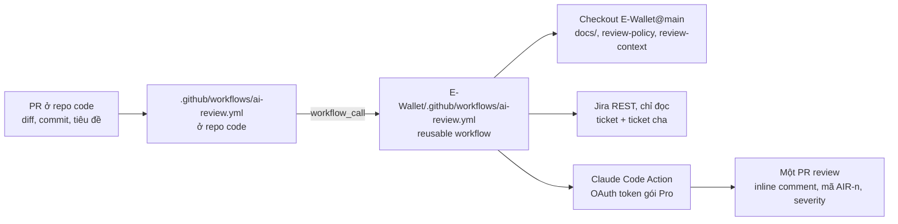

# Quy trình review PR bằng Claude

> Trạng thái: **DRAFT — advisory, chặn merge cho `uat/v1.0.0`** · Cập nhật: 2026-10-28
> Liên quan: [review-policy.md](review-policy.md) (quy tắc chung cho reviewer) · [review-context.md](review-context.md) (thành phần → tài liệu cần đọc) · [architecture.md §13](architecture.md#13-adr-tóm-tắt) (ADR-16…22) · [progression/ai-review-metrics.md](../progression/ai-review-metrics.md)

Tài liệu này thay cho bản ghi chép `review_plan/planning.md` (2026-10-28). Các quyết định đã được chủ dự án xác nhận qua bộ câu hỏi Q-R01…Q-R28 cùng ngày.

## 1. Mục tiêu

Mỗi PR vào repo code được Claude review **trong ngữ cảnh** của ticket Jira, tài liệu nghiệp vụ và kiến trúc, chứ không chỉ đọc diff. Với ví điện tử, reviewer phải trả lời được các câu hỏi như:

- Có thể trừ tiền ví A mà không cộng tiền ví B không?
- Hai request đồng thời có làm trừ tiền hai lần không?
- Retry cùng `Idempotency-Key` có tạo hai giao dịch không?
- Code có vi phạm máy trạng thái (erd §6), ma trận bút toán (erd §3.2) hay `BR-xx` không?
- Có thiếu test cho trường hợp nghiệp vụ quan trọng không?

Reviewer **chỉ nhận xét**. Người merge luôn là chủ dự án.

## 2. Các quyết định

| ADR | Quyết định | Nguồn |
|---|---|---|
| ADR-16 | Polyrepo; repo `E-Wallet` (docs) là trung tâm, mỗi thành phần một repo code | Q-R04, Q-R06 |
| ADR-17 | Claude Code Action trên GitHub Actions, xác thực bằng gói Claude Pro (OAuth token); service riêng (phương án C) để dành cho sau | Q-R01…03, Q-R24 |
| ADR-18 | `REVIEW.md` ở từng repo code; quy tắc chung ở [review-policy.md](review-policy.md); thang P0–P3; comment tiếng Việt | Q-R07…10 |
| ADR-19 | Lấy ticket Jira qua REST API chỉ đọc; docs nhánh `main` là nguồn chuẩn khi lệch với Jira (ngoại lệ: OpenAPI wallet-core theo Q-07) | Q-R11…15 |
| ADR-20 | Advisory đến hết Sprint 1; sau đó chặn merge bằng required status checks, không bật "required approvals" | Q-R16…19 |
| ADR-21 | Không tổ chức lại thư mục docs; reviewer chọn context qua [review-context.md](review-context.md) | Q-R20, Q-R21 |
| ADR-22 | Reviewer không tự kích hoạt sửa lỗi; tối đa 3 vòng review mỗi PR | Q-R22, Q-R23 |
| ADR-23 | Chỉ tự chạy cho PR vào `uat/v1.0.0`; với nhánh này chặn merge khi có P0/P1 | Yêu cầu của chủ dự án, 2026-10-28 |

Chi tiết lý do và phương án đã cân nhắc nằm ở bảng ADR trong architecture.md §13.

## 3. Kiến trúc

- Workflow review viết **một lần** trong repo docs. Repo code mới (corebank-sim, merchant-sim, mobile, bo-web) chỉ cần file gọi khoảng 15 dòng, truyền tên thành phần, và một `REVIEW.md`.
- Mọi repo đều public nên không cần token để checkout docs.
- PR là đơn vị review; review luôn ghi rõ base SHA và head SHA đã kiểm tra.

## 4. Luồng chạy

### 4.1. Khi nào chạy

| Sự kiện | Chạy? |
|---|---|
| PR vào `uat/v1.0.0` được mở (không phải draft), chuyển sang ready, hoặc có push mới | Có (tối đa 3 vòng, ADR-22) |
| PR vào nhánh khác (`development`…) được mở hoặc push | **Không** (tiết kiệm hạn mức) |
| Chủ repo comment `@claude review` trên bất kỳ PR nào | Có (chỉ để tham khảo, không ảnh hưởng merge gate) |
| PR từ fork, hoặc comment của người không phải chủ repo | Không |

### 4.2. Các bước

1. **Kiểm tra điều kiện.** Thiếu secret `CLAUDE_CODE_OAUTH_TOKEN` thì bỏ qua và ghi chú. Đã có 3 review AI trên PR thì dừng (mục 6).
2. **Lấy context.** Checkout PR head (đủ lịch sử để diff với base), checkout `E-Wallet@main` vào `e-wallet-docs/`.
3. **Lấy ticket Jira.** Gom key `SCRUM-NN` từ tiêu đề PR và mọi commit message. Với mỗi key, lấy summary, mô tả, trạng thái; nếu là sub-task thì lấy thêm ticket cha (nơi có AC). Ghi ra `.ai-review/jira.md`. Không có secret Jira thì ghi "không lấy được context Jira".
4. **Claude review** theo [review-policy.md](review-policy.md) và `REVIEW.md` của repo: tính đúng của code, nghiệp vụ (AC, `BR-xx`, `UC-xx`), kiến trúc và quy ước, test và kịch bản lỗi; tự xác minh lại từng finding trước khi đăng.
5. **Đăng kết quả**: inline comment cho từng finding và một comment tổng hợp có marker `<!-- ai-review -->`.

### 4.3. Hết hạn mức

Review chỉ dùng hạn mức gói Claude Pro, không chuyển sang API trả tiền. Khi hết hạn mức 5 giờ hoặc hạn mức tuần, bước Claude lỗi; workflow ghi chú "bỏ qua vì hết hạn mức" và job vẫn kết thúc thành công để không chặn merge.

## 5. Merge gate

| Điều kiện | PR vào `uat/v1.0.0` (ADR-23) | PR vào nhánh khác |
|---|---|---|
| CI (`lint`, `test`, `openapi`) đỏ | Chặn merge (required status check) | Chủ dự án tự xem |
| Reviewer báo P0/P1 | Chặn merge: job `review / review` fail ở bước *Merge gate* | Chủ dự án tự xem |
| Chỉ có P2/P3 | Chủ dự án quyết định | Chủ dự án quyết định |
| Không có finding | Chỉ là tín hiệu tốt, không chứng minh code đúng | như trên |
| Review không chạy (hết hạn mức, đủ 3 vòng, thiếu secret) | Không chặn; chủ dự án tự đọc PR | — |

Cách gate hoạt động: reviewer ghi dòng `<!-- ai-review-verdict: p0=N p1=M -->` ở cuối comment tổng hợp; bước *Merge gate* đọc dòng đó của đúng lần chạy hiện tại và fail khi N+M > 0. Sửa lỗi rồi push để review lại. Lần chạy bằng `@claude review` gắn vào nhánh mặc định chứ không vào head của PR, nên không mở được gate.

Bật gate (một lần, trong GitHub): **Settings → Rules → Rulesets → New branch ruleset**, target `uat/v1.0.0`, bật *Require a pull request before merging* (không cần approval) và *Require status checks to pass* với các check `lint`, `test`, `openapi`, `review / review`.

Không bật "Require approvals": GitHub không cho tác giả tự approve PR của mình, nên với dự án một người tùy chọn này sẽ khóa merge. "Human review" nghĩa là chủ dự án đọc kết quả rồi tự bấm merge.

## 6. Vòng lặp reviewer và tác giả

- Thread Claude đã tạo PR **không tự sửa** finding của AI reviewer. Chủ dự án quay lại thread đó và yêu cầu sửa; thread đọc lại review theo mã `AIR-n`.
- Mỗi PR tối đa **3 vòng** review AI. Đến vòng thứ 4, workflow chỉ đăng "đã đủ 3 vòng, cần người quyết định". Lý do: sau vài vòng hai agent trao đổi, lỗi thường chưa được sửa tận gốc hoặc phát sinh lỗi mới.

## 7. Lộ trình

| Giai đoạn | Việc | Trạng thái |
|---|---|---|
| 0 | CI cho wallet-core (SCRUM-15) | Đang làm |
| 1 | Tài liệu: file này, review-policy, review-context, ADR-16…22, `CLAUDE.md` cho repo docs; `REVIEW.md` cho wallet-core | Đang làm |
| 2 | Workflow advisory ở wallet-core; chạy thử trên PR cũ #1, #5, #6, #7 và một PR riêng cho commit SCRUM-25 (lỗi đã biết ở ISS-41), ghi kết quả vào bảng đo | Đang làm (đã chạy #1, #7) |
| 3 | Kết nối Jira (cần secret `JIRA_BASE_URL`, `JIRA_EMAIL`, `JIRA_API_TOKEN`) | Workflow đã hỗ trợ, chờ secret |
| 4 | Chặn merge cho PR vào `uat/v1.0.0` (ADR-23); chủ dự án bật ruleset | Workflow xong, chờ ruleset |

## 8. Cài đặt cho một repo code

1. Chạy `claude setup-token` trên máy, lưu kết quả vào secret `CLAUDE_CODE_OAUTH_TOKEN` của repo.
2. (Tùy chọn) Tạo API token Jira cho tài khoản chỉ có quyền đọc project SCRUM; lưu `JIRA_BASE_URL` (`https://e-wallet-platform.atlassian.net`), `JIRA_EMAIL`, `JIRA_API_TOKEN`.
3. Thêm `REVIEW.md` ở root và file gọi workflow (mẫu: `E-Wallet-Wallet-Core/.github/workflows/ai-review.yml`).
4. Thêm mục cho thành phần đó trong [review-context.md](review-context.md).

## 9. Đo chất lượng reviewer

Ghi vào [progression/ai-review-metrics.md](../progression/ai-review-metrics.md): tỷ lệ finding đúng, lỗi quan trọng bị bỏ sót, finding trùng hoặc thiếu bằng chứng, thời gian chạy. Không đánh giá bằng số lượng comment.

## 10. Lịch sử

- 2026-10-28: Bản đầu, viết lại từ `review_plan/planning.md` theo câu trả lời Q-R01…Q-R28.
- 2026-10-28: ADR-23: review tự động chỉ cho PR vào `uat/v1.0.0`, chặn merge khi có P0/P1.
- 2026-10-28: Giai đoạn 2 bắt đầu (#1, #7). Reviewer đọc `REVIEW.md` từ nhánh mặc định khi head chưa có file.
